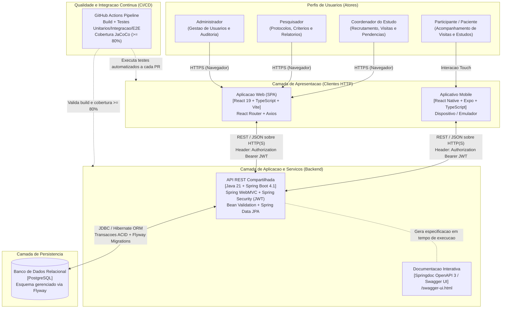
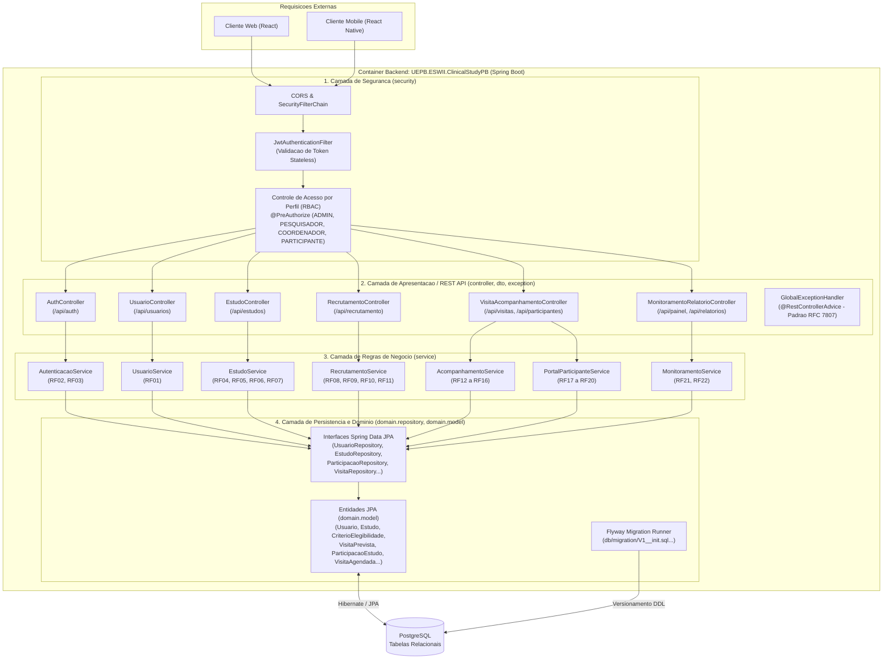
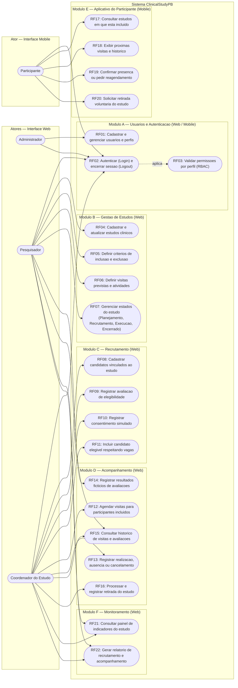
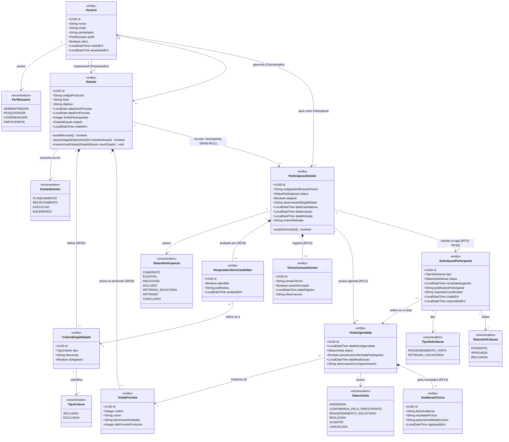
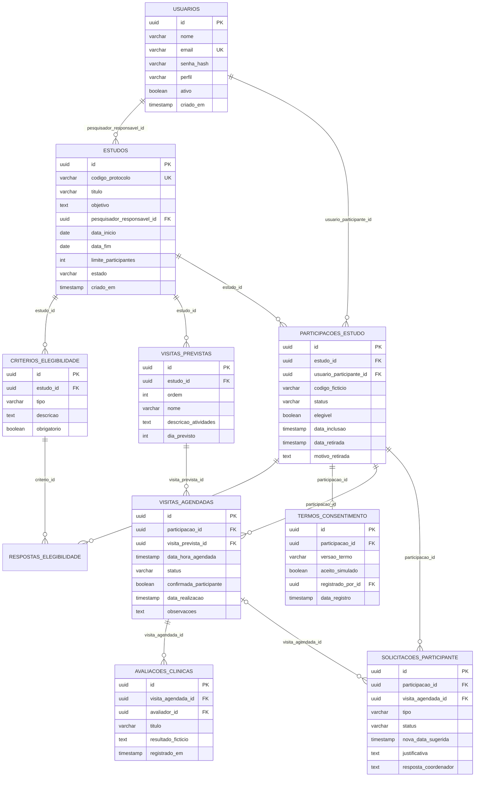
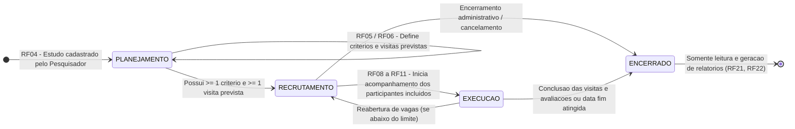
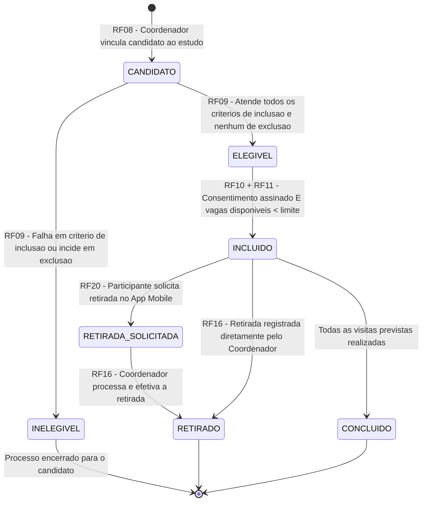
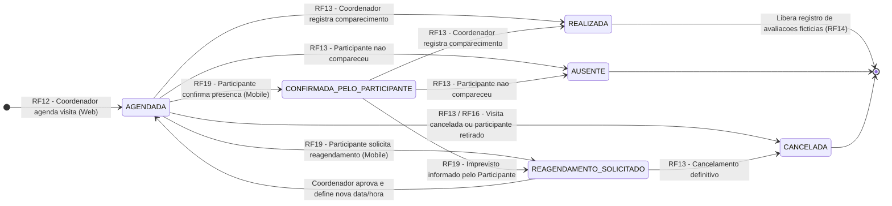

# Documento de Arquitetura de Software (DAS) — ClinicalStudyPB

> **Projeto:** ClinicalStudyPB — Sistema de Gestão de Estudos Clínicos  
> **Disciplina:** Engenharia de Software II (2026.2) — UEPB  
> **Escopo deste documento:** Definição arquitetural completa (PBI-01: T01 e T03), contemplando a visão de containers (C4 Nível 2), arquitetura interna em camadas do backend (C4 Nível 3), casos de uso e matriz RBAC, modelo de domínio (diagrama de classes UML e DER), máquinas de estados e diagramas de sequência dos fluxos críticos.

---

## Sumário

1. [Visão Arquitetural e Princípios de Projeto](#1-visão-arquitetural-e-princípios-de-projeto)
2. [Diagrama de Arquitetura Geral — Visão de Containers (C4 Nível 2)](#2-diagrama-de-arquitetura-geral--visão-de-containers-c4-nível-2)
3. [Diagrama de Componentes do Backend — Arquitetura em Camadas (C4 Nível 3)](#3-diagrama-de-componentes-do-backend--arquitetura-em-camadas-c4-nível-3)
4. [Diagrama de Casos de Uso e Matriz de Permissões (RBAC)](#4-diagrama-de-casos-de-uso-e-matriz-de-permissões-rbac)
5. [Modelo de Domínio — Diagrama de Classes UML e DER](#5-modelo-de-domínio--diagrama-de-classes-uml-e-der)
6. [Diagramas de Máquina de Estados (Ciclos de Vida)](#6-diagramas-de-máquina-de-estados-ciclos-de-vida)
7. [Diagramas de Sequência dos Principais Fluxos](#7-diagramas-de-sequência-dos-principais-fluxos)
8. [Estrutura de Pacotes e Diretórios](#8-estrutura-de-pacotes-e-diretórios)
9. [Registro de Decisões Arquiteturais (ADRs)](#9-registro-de-decisões-arquiteturais-adrs)

---

## 1. Visão Arquitetural e Princípios de Projeto

O **ClinicalStudyPB** adota uma arquitetura **Cliente-Servidor distribuída orientada a API RESTful**, na qual um **Backend centralizado em Java 21 + Spring Boot** concentra todas as regras de negócio, validações de domínio, controle de acesso baseado em papéis (**RBAC — Role-Based Access Control**) e persistência transacional em **PostgreSQL**. Duas aplicações clientes independentes consomem essa API:

1. **Aplicação Web (SPA em React + TypeScript + Vite):** Voltada para os perfis operacionais e administrativos (**Administrador**, **Pesquisador** e **Coordenador do Estudo**), cobrindo os módulos A, B, C, D e F (`RF01` a `RF16`, `RF21` e `RF22`).
2. **Aplicativo Mobile (React Native + Expo + TypeScript):** Voltado exclusivamente para o **Participante** do estudo clínico, cobrindo autenticação e o Módulo E (`RF02`, `RF03`, `RF17` a `RF20`).

### Princípios Arquiteturais Adotados
- **Single Source of Truth (Fonte Única da Verdade):** Nenhuma regra de negócio crítica (como elegibilidade, transição de estados de um estudo ou verificação de limite de vagas) reside exclusivamente no frontend. Web e Mobile atuam como camadas de apresentação e experiência do usuário.
- **API-First & Documentação Viva:** Todos os contratos HTTP REST seguem o padrão **OpenAPI 3**, gerados automaticamente via `springdoc-openapi` e inspecionáveis via **Swagger UI**.
- **Segurança Stateless (JWT) e Defesa em Profundidade:** Autenticação via tokens assinados (JWT) e autorização declarativa nos endpoints do Spring Security (`@PreAuthorize`), complementada por rotas protegidas no React Router e no Expo.
- **Manutenibilidade e Evolução Controlada (Preparação para a Release 3):** Como o projeto passará por manutenção evolutiva por outra equipe na Release 3, o código adota baixo acoplamento, alta coesão, migrações versionadas com **Flyway** e meta mínima de **80% de cobertura de testes nas regras de negócio**.

---

## 2. Diagrama de Arquitetura Geral — Visão de Containers (C4 Nível 2)

Este diagrama representa a comunicação entre os atores, as interfaces clientes (**Web** e **Mobile**), o **Backend (API REST)**, o **Banco de Dados** e a esteira de **Integração Contínua (CI)**.



---

## 3. Diagrama de Componentes do Backend — Arquitetura em Camadas (C4 Nível 3)

O backend em **Spring Boot** segue uma **Arquitetura em Camadas (Layered Architecture)** estrita com separação entre modelos de transferência de dados (**DTOs**) e entidades de domínio/persistência (**JPA Entities**), evitando exposição direta do modelo relacional na API.



### Responsabilidades de Cada Camada
1. **Camada de Segurança (`security`):** Intercepta todas as requisições HTTP, valida a assinatura e expiração do token JWT, popula o `SecurityContext` do Spring e bloqueia acessos não autorizados conforme o perfil do usuário (`RF02`, `RF03`).
2. **Camada de Apresentação (`controller`, `dto`, `exception`):** Recebe e responde JSON via DTOs validados com `jakarta.validation` (`@NotBlank`, `@Email`, `@Future`, etc.), aciona os serviços correspondentes e padroniza respostas de erro HTTP (`400 Bad Request`, `401 Unauthorized`, `403 Forbidden`, `404 Not Found`, `422 Unprocessable Entity`) através de um `@RestControllerAdvice`.
3. **Camada de Negócio (`service`):** Contém toda a lógica operacional de estudos clínicos (transição de estados do estudo, verificação de critérios de inclusão/exclusão, checagem de consentimento e limite de vagas antes de incluir participante, reagendamentos e retirada). É o alvo principal da cobertura mínima de **80% de testes unitários**.
4. **Camada de Persistência e Domínio (`domain.model`, `domain.repository`):** Mapeia as entidades de domínio para tabelas do PostgreSQL via JPA/Hibernate e gerencia a evolução do esquema relacional por meio de scripts SQL versionados no **Flyway**.

---

## 4. Diagrama de Casos de Uso e Matriz de Permissões (RBAC)

O diagrama abaixo mapeia os **4 perfis de usuários** aos **22 Requisitos Funcionais (`RF01` a `RF22`)** organizados pelos 6 módulos do sistema, destacando a fronteira entre as interfaces **Web** e **Mobile**.



### Matriz de Controle de Acesso por Perfil (RBAC — RF03)

| Código | Funcionalidade | Administrador (Web) | Pesquisador (Web) | Coordenador (Web) | Participante (Mobile) |
|:---:|---|:---:|:---:|:---:|:---:|
| **RF01** | Cadastrar, listar, ativar/desativar usuários e gerir perfis | ✅ | ❌ | ❌ | ❌ |
| **RF02** | Autenticar no sistema (login) e encerrar sessão (logout) | ✅ | ✅ | ✅ | ✅ |
| **RF03** | Controle de acesso e restrição de rotas/endpoints por perfil | ✅ | ✅ | ✅ | ✅ |
| **RF04** | Cadastrar e atualizar estudos clínicos (protocolos) | ❌ | ✅ | 👁️ *(Leitura)* | ❌ |
| **RF05** | Definir critérios de inclusão e exclusão do estudo | ❌ | ✅ | 👁️ *(Leitura)* | ❌ |
| **RF06** | Definir visitas previstas do protocolo e suas atividades | ❌ | ✅ | 👁️ *(Leitura)* | ❌ |
| **RF07** | Alterar estado do estudo (`PLANEJAMENTO` → `ENCERRADO`) | ❌ | ✅ | ❌ | ❌ |
| **RF08** | Cadastrar candidatos vinculados a um estudo em recrutamento | ❌ | 👁️ *(Leitura)* | ✅ | ❌ |
| **RF09** | Avaliar e registrar atendimento aos critérios de elegibilidade | ❌ | 👁️ *(Leitura)* | ✅ | ❌ |
| **RF10** | Registrar consentimento livre e esclarecido (simulado) | ❌ | 👁️ *(Leitura)* | ✅ | ❌ |
| **RF11** | Incluir candidato elegível no estudo (respeitando vagas) | ❌ | 👁️ *(Leitura)* | ✅ | ❌ |
| **RF12** | Agendar visitas para participantes incluídos | ❌ | 👁️ *(Leitura)* | ✅ | ❌ |
| **RF13** | Registrar realização, ausência ou cancelamento de visita | ❌ | 👁️ *(Leitura)* | ✅ | ❌ |
| **RF14** | Registrar resultados fictícios das avaliações clínicas | ❌ | ✅ | ✅ | ❌ |
| **RF15** | Consultar histórico de visitas e avaliações do participante | ❌ | ✅ | ✅ | ❌ |
| **RF16** | Registrar retirada de participante / processar solicitações | ❌ | 👁️ *(Leitura)* | ✅ | ❌ |
| **RF17** | Consultar estudos em que o próprio participante está incluído | ❌ | ❌ | ❌ | ✅ *(Próprios)* |
| **RF18** | Exibir próximas visitas agendadas e histórico de presença | ❌ | ❌ | ❌ | ✅ *(Próprios)* |
| **RF19** | Confirmar presença prevista ou solicitar reagendamento | ❌ | ❌ | ❌ | ✅ *(Próprios)* |
| **RF20** | Solicitar retirada voluntária do estudo pelo aplicativo | ❌ | ❌ | ❌ | ✅ *(Próprios)* |
| **RF21** | Visualizar painel consolidado de indicadores do estudo | ❌ | ✅ | ✅ | ❌ |
| **RF22** | Gerar relatório simplificado de recrutamento e acompanhamento | ❌ | ✅ | ✅ | ❌ |

---

## 5. Modelo de Domínio — Diagrama de Classes UML e DER

### 5.1. Diagrama de Classes de Domínio (UML)

O modelo abaixo evolui a entidade [`Usuario`](../backend/ClinicalStudyPB/src/main/java/UEPB/ESWII/ClinicalStudyPB/domain/model/Usuario.java) já iniciada no repositório para abranger todo o domínio de estudos clínicos (Módulos A a F), garantindo rastreabilidade e integridade referencial.



### 5.2. Diagrama Entidade-Relacionamento (DER — Modelo Físico PostgreSQL)

Visão das tabelas relacionais que serão gerenciadas via **Flyway Migrations** no PostgreSQL:



---

## 6. Diagramas de Máquina de Estados (Ciclos de Vida)

Como o ClinicalStudyPB gerencia o ciclo de vida operacional de estudos clínicos, três máquinas de estados governam as regras de transição na camada de negócio (`service`).

### 6.1. Máquina de Estados do Estudo Clínico (RF07)



### 6.2. Máquina de Estados do Candidato / Participante no Estudo (RF08 a RF11, RF16, RF20)



### 6.3. Máquina de Estados da Visita Agendada (RF12, RF13, RF19)



---

## 7. Diagramas de Sequência dos Principais Fluxos

### 7.1. Fluxo 1: Autenticação Stateless (JWT) e Controle de Acesso por Perfil (RF02 e RF03 — Sprint 1)

Demonstra o processo de login compartilhado entre Web e Mobile e como o `JwtAuthenticationFilter` protege os endpoints subsequentes.

```mermaid
sequenceDiagram
    autonumber
    actor User as Usuario (Web ou Mobile)
    participant Client as Cliente (React / React Native)
    participant AuthCtrl as AuthController
    participant SecFilter as JwtAuthenticationFilter
    participant AuthSvc as AutenticacaoService
    participant UserRepo as UsuarioRepository
    database DB as PostgreSQL

    Note over User, DB: Etapa 1 — Autenticacao (RF02)
    User->>Client: Informa e-mail e senha
    Client->>AuthCtrl: POST /api/auth/login {email, senha}
    AuthCtrl->>AuthSvc: autenticar(LoginRequestDTO)
    AuthSvc->>UserRepo: findByEmailAndAtivoTrue(email)
    UserRepo->>DB: SELECT * FROM usuarios WHERE email = ? AND ativo = true
    DB-->>UserRepo: Registro do Usuario
    UserRepo-->>AuthSvc: Optional<Usuario>

    alt Credenciais invalidas ou usuario inativo
        AuthSvc-->>AuthCtrl: Lanca BadCredentialsException
        AuthCtrl-->>Client: HTTP 401 Unauthorized {mensagem: "Credenciais invalidas"}
        Client-->>User: Exibe feedback de erro na tela
    else Credenciais validas (BCryptPasswordEncoder.matches)
        AuthSvc->>AuthSvc: Gera Token JWT (sub: userId, role: perfil, exp)
        AuthSvc-->>AuthCtrl: LoginResponseDTO {token, tipo, usuario, perfil}
        AuthCtrl-->>Client: HTTP 200 OK {token, perfil}
        Client->>Client: Armazena JWT e redireciona conforme Perfil
        Client-->>User: Exibe Dashboard correspondente ao perfil
    end

    Note over User, DB: Etapa 2 — Acesso a Recurso Protegido por Perfil (RF03)
    User->>Client: Aciona funcionalidade restrita (ex: Cadastrar Estudo - RF04)
    Client->>SecFilter: POST /api/estudos (Authorization: Bearer <JWT>)
    SecFilter->>SecFilter: Valida assinatura e expiracao do JWT
    SecFilter->>SecFilter: Extrai role (ex: ROLE_PESQUISADOR) para o SecurityContext

    alt Perfil sem permissao para o endpoint
        SecFilter-->>Client: HTTP 403 Forbidden {mensagem: "Acesso negado para este perfil"}
    else Perfil autorizado (@PreAuthorize("hasRole('PESQUISADOR')"))
        SecFilter->>AuthCtrl: Encaminha requisicao ao Controller de destino
        AuthCtrl-->>Client: HTTP 201 Created
    end
```

---

### 7.2. Fluxo 2: Recrutamento, Avaliação de Elegibilidade, Consentimento e Inclusão no Estudo (RF08 a RF11 — Release 1)

Demonstra as validações críticas de regras de negócio no backend ao avaliar um candidato e incluí-lo como participante de um estudo clínico.

```mermaid
sequenceDiagram
    autonumber
    actor Coord as Coordenador do Estudo (Web)
    participant Web as React SPA
    participant Ctrl as RecrutamentoController
    participant Svc as RecrutamentoService
    participant StudyRepo as EstudoRepository
    participant PartRepo as ParticipacaoRepository
    database DB as PostgreSQL

    Note over Coord, DB: 1. Avaliacao de Elegibilidade (RF09) e Consentimento (RF10)
    Coord->>Web: Preenche checklist de criterios (RF09) e registra consentimento (RF10)
    Web->>Ctrl: POST /api/estudos/{estudoId}/candidatos/{id}/avaliar
    Ctrl->>Svc: registrarElegibilidadeEConsentimento(estudoId, id, dto)
    Svc->>PartRepo: findByIdAndEstudoId(id, estudoId)
    PartRepo->>DB: SELECT participacao + criterios do estudo
    DB-->>PartRepo: Dados do Candidato e Criterios
    Svc->>Svc: Verifica todos criterios INCLUSAO atendidos e nenhum EXCLUSAO violado
    Svc->>PartRepo: save(participacao com status ELEGIVEL + TermoConsentimento)
    PartRepo->>DB: UPDATE participacoes_estudo / INSERT termos_consentimento
    Svc-->>Ctrl: ParticipacaoResponseDTO (status: ELEGIVEL, consentimento: true)
    Ctrl-->>Web: HTTP 200 OK

    Note over Coord, DB: 2. Inclusao Efetiva do Participante no Estudo (RF11)
    Coord->>Web: Clica em "Incluir Participante no Estudo"
    Web->>Ctrl: POST /api/estudos/{estudoId}/candidatos/{id}/incluir
    Ctrl->>Svc: incluirParticipante(estudoId, id)
    Svc->>StudyRepo: findById(estudoId)
    StudyRepo->>DB: SELECT * FROM estudos WHERE id = ?
    DB-->>StudyRepo: Estudo (estado, limiteParticipantes)
    Svc->>PartRepo: countByEstudoIdAndStatus(estudoId, INCLUIDO)
    PartRepo->>DB: SELECT COUNT(*) FROM participacoes_estudo WHERE status = 'INCLUIDO'
    DB-->>PartRepo: totalIncluidos

    alt Estudo fora de RECRUTAMENTO, Candidato Inelegivel, Sem Consentimento ou Limite Atingido
        Svc-->>Ctrl: Lanca RegraNegocioException (motivo especifico)
        Ctrl-->>Web: HTTP 422 Unprocessable Entity {erro: "Limite de vagas atingido ou candidato sem consentimento"}
        Web-->>Coord: Exibe alerta de impedimento
    else Candidato Elegivel + Consentimento Assinado + Vagas Disponiveis
        Svc->>Svc: Altera status para INCLUIDO e define dataInclusao = now()
        Svc->>PartRepo: save(participacao)
        PartRepo->>DB: UPDATE participacoes_estudo SET status = 'INCLUIDO'
        DB-->>PartRepo: Confirmado
        Svc-->>Ctrl: ParticipacaoResponseDTO (status: INCLUIDO)
        Ctrl-->>Web: HTTP 200 OK
        Web-->>Coord: Exibe confirmacao de inclusao no estudo
    end
```

---

### 7.3. Fluxo 3: Integração Web ↔ Mobile no Acompanhamento de Visitas (RF12, RF13, RF18, RF19)

Demonstra a integração ponta a ponta entre o **Coordenador do Estudo (Web)** e o **Participante (Mobile)** por meio do backend compartilhado.

```mermaid
sequenceDiagram
    autonumber
    actor Coord as Coordenador (Web)
    participant Web as React Web
    participant API as Backend Spring Boot
    database DB as PostgreSQL
    participant Mobile as App Mobile (Expo)
    actor Part as Participante (Mobile)

    Note over Coord, DB: 1. Agendamento da Visita na Interface Web (RF12)
    Coord->>Web: Seleciona participante incluido, visita prevista e data/hora
    Web->>API: POST /api/visitas-agendadas {participacaoId, visitaPrevistaId, dataHora}
    API->>DB: INSERT INTO visitas_agendadas (status = 'AGENDADA')
    DB-->>API: Visita criada
    API-->>Web: HTTP 201 Created

    Note over DB, Part: 2. Consulta e Confirmacao / Pedido de Reagendamento no Mobile (RF18, RF19)
    Part->>Mobile: Abre tela "Minhas Visitas"
    Mobile->>API: GET /api/me/visitas (Bearer JWT do Participante)
    API->>DB: SELECT * FROM visitas_agendadas WHERE usuario_participante_id = ?
    DB-->>API: Lista de proximas visitas e historico
    API-->>Mobile: HTTP 200 OK [Visitas]
    Mobile-->>Part: Exibe proxima visita agendada

    alt Participante confirma presenca (RF19)
        Part->>Mobile: Toca em "Confirmar Presenca"
        Mobile->>API: PATCH /api/me/visitas/{visitaId}/confirmar
        API->>DB: UPDATE visitas_agendadas SET status = 'CONFIRMADA_PELO_PARTICIPANTE'
        API-->>Mobile: HTTP 200 OK
        Mobile-->>Part: Exibe selo "Presenca Confirmada"
    else Participante solicita reagendamento (RF19)
        Part->>Mobile: Toca em "Solicitar Reagendamento" e informa justificativa/data
        Mobile->>API: POST /api/me/visitas/{visitaId}/reagendamento {novaData, justificativa}
        API->>DB: INSERT INTO solicitacoes_participante / UPDATE visita status = 'REAGENDAMENTO_SOLICITADO'
        API-->>Mobile: HTTP 201 Created
        Mobile-->>Part: Exibe status "Aguardando avaliacao do Coordenador"
    end

    Note over Coord, DB: 3. Registro de Realizacao e Avaliacao Clinica na Web (RF13, RF14)
    Coord->>Web: Registra realizacao da visita e resultados ficticios da avaliacao
    Web->>API: PATCH /api/visitas-agendadas/{visitaId}/realizar + POST /api/avaliacoes
    API->>DB: UPDATE visitas_agendadas SET status = 'REALIZADA' / INSERT INTO avaliacoes_clinicas
    API-->>Web: HTTP 200 OK
```

---

## 8. Estrutura de Pacotes e Diretórios

Para garantir organização e padronização entre os 7 integrantes (e facilitar a entrega para outra equipe na Release 3), a estrutura interna de cada módulo segue o padrão abaixo:

```text
ClinicalStudyPB/
├── backend/ClinicalStudyPB/
│   └── src/main/
│       ├── java/UEPB/ESWII/ClinicalStudyPB/
│       │   ├── ClinicalStudyPbApplication.java
│       │   ├── config/             # Configuracoes de CORS, OpenAPI (Swagger) e Beans
│       │   ├── security/           # Spring Security, JwtService, JwtAuthenticationFilter
│       │   ├── controller/         # Controllers REST (@RestController)
│       │   ├── dto/                # Records Java para Request/Response + Bean Validation
│       │   ├── service/            # Regras de negocio (@Service) — Foco de cobertura >= 80%
│       │   ├── domain/
│       │   │   ├── model/          # Entidades JPA (@Entity) — ex: Usuario.java, Estudo.java
│       │   │   ├── enums/          # Enumeracoes de dominio (PerfilUsuario, EstadoEstudo...)
│       │   │   └── repository/     # Interfaces Spring Data JPA (@Repository)
│       │   └── exception/          # Excecoes de negocio e GlobalExceptionHandler
│       └── resources/
│           ├── application.properties
│           └── db/migration/       # Scripts SQL versionados do Flyway (V1__..., V2__...)
│
├── web/ClinicalStudyPB/
│   └── src/
│       ├── api/                    # Instancia do Axios e interceptors de JWT
│       ├── components/             # Componentes visuais reutilizaveis e guards de rota
│       ├── contexts/               # Contexto de Autenticacao e Sessao (AuthContext)
│       ├── pages/                  # Telas por modulo (Usuarios, Estudos, Recrutamento, Visitas, Painel)
│       ├── routes/                 # Definicao de rotas publicas e privadas por perfil
│       └── types/                  # Interfaces TypeScript espelhando os DTOs da API
│
└── mobile/ClinicalStudyPB/
    └── src/
        ├── api/                    # Cliente HTTP para comunicacao com o backend
        ├── components/             # Cards de visitas, estudos e botoes de acao
        ├── contexts/               # Estado de autenticacao do participante
        ├── navigation/             # Navegacao do app ( Login -> Estudos -> Visitas -> Solicitacoes )
        └── screens/                # Telas exclusivas do perfil Participante (RF17 a RF20)
```

---

## 9. Registro de Decisões Arquiteturais (ADRs)

| ID | Decisão | Justificativa Técnica |
|:---:|---|---|
| **ADR-01** | **Adotar Stack A (Spring Boot + React + React Native/Expo + PostgreSQL)** | Forte tipagem estática em todas as camadas (Java 21 + TypeScript), ecossistema maduro de segurança (`Spring Security`) e persistência (`Spring Data JPA` + `Flyway`), além de compartilhamento de conhecimento entre React Web e React Native Mobile. |
| **ADR-02** | **Autenticação Stateless via Token JWT** | Permite que a mesma API REST autentique tanto a SPA Web quanto o aplicativo Mobile sem depender de sessões de servidor ou cookies restritos a navegadores. |
| **ADR-03** | **Separação estrita entre Entidades JPA e DTOs (Java Records)** | Evita vulnerabilidades de *Mass Assignment*, recursão infinita na serialização JSON de relacionamentos bidirecionais JPA e acoplamento direto das telas com o esquema do banco de dados. |
| **ADR-04** | **Versionamento de Banco de Dados com Flyway** | Garante que qualquer integrante da equipe — e a equipe receptora na Release 3 — suba o banco de dados PostgreSQL exatamente com a mesma estrutura e carga de dados fictícios (`seed`) de forma determinística. |
| **ADR-05** | **Diagramas as Code em Mermaid no Repositório** | Permite versionar os diagramas junto com o código no Git, renderizar nativamente no GitHub e atualizar facilmente durante a manutenção evolutiva da Release 3 sem depender de arquivos binários proprietários. |
