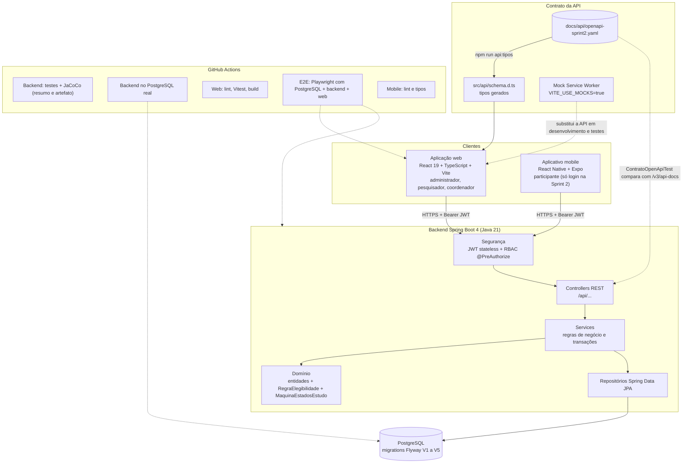

# Arquitetura atualizada (T69)

Visão dos componentes ao fim da Sprint 2, com o que cada parte faz e como são verificadas. O detalhamento por camadas e o modelo de dados anteriores estão em [docs/sprint1/arquitetura.md](../sprint1/arquitetura.md).

| Parte | Observação |
|---|---|
| Autenticação | `POST /api/auth/login` devolve um JWT (HS256, 30 minutos); `GET /api/auth/me` devolve o usuário do token |
| Autorização | Matriz por perfil em `security/Permissoes`; sem token 401, perfil sem permissão 403 |
| Erros | `{"erro", "codigo?"}`; 409 para regra de negócio violada, sempre com `codigo` |
| Concorrência | A inclusão de participantes e a geração do código do candidato bloqueiam o estudo (`PESSIMISTIC_WRITE`) |
| Cobertura | JaCoCo mede domínio e serviços; mínimo de 80% de linhas, com bloqueio ligado no CI (`COBERTURA_BLOQUEAR: 'true'`) |
