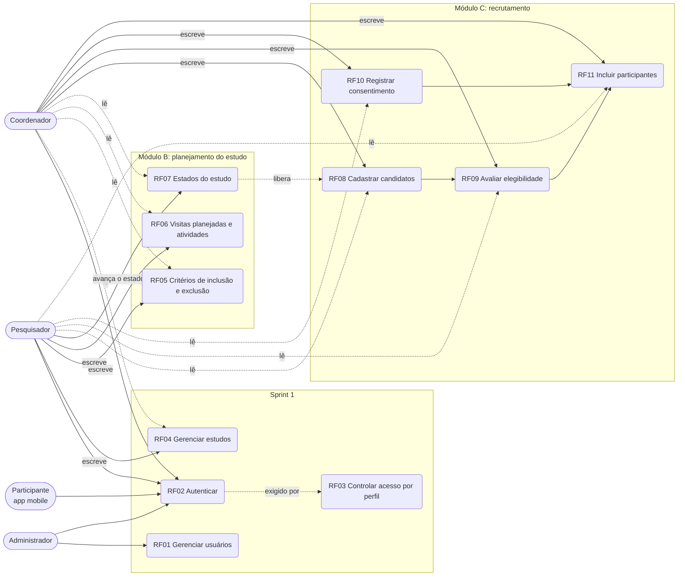

# Casos de uso (T69)

Quatro perfis e os requisitos RF01 a RF11, conforme a matriz de permissões implementada (`@PreAuthorize` e `security/Permissoes`). "Escreve" inclui criar, editar e excluir; "lê" é só consulta. O participante usa o aplicativo mobile, que na Sprint 2 só tem o login.

Legenda: seta cheia = o perfil escreve; seta tracejada = só lê. O administrador não acessa nenhum requisito de RF04 a RF11 (recebe 403).

| Requisito | Administrador | Pesquisador | Coordenador | Participante |
|---|:---:|:---:|:---:|:---:|
| RF01 Usuários | escreve | — | — | — |
| RF02 Autenticação | ✔ | ✔ | ✔ | ✔ (login mobile na Sprint 3) |
| RF04 Estudos | — | escreve | lê | — |
| RF05 Critérios | — | escreve (em planejamento) | lê | — |
| RF06 Visitas e atividades | — | escreve (em planejamento) | lê | — |
| RF07 Estados do estudo | — | avança | lê o histórico | — |
| RF08 Candidatos | — | lê | escreve (em recrutamento) | — |
| RF09 Elegibilidade | — | lê | escreve (em recrutamento) | — |
| RF10 Consentimento | — | lê | escreve (em recrutamento) | — |
| RF11 Participantes | — | lê | escreve (em recrutamento) | — |
