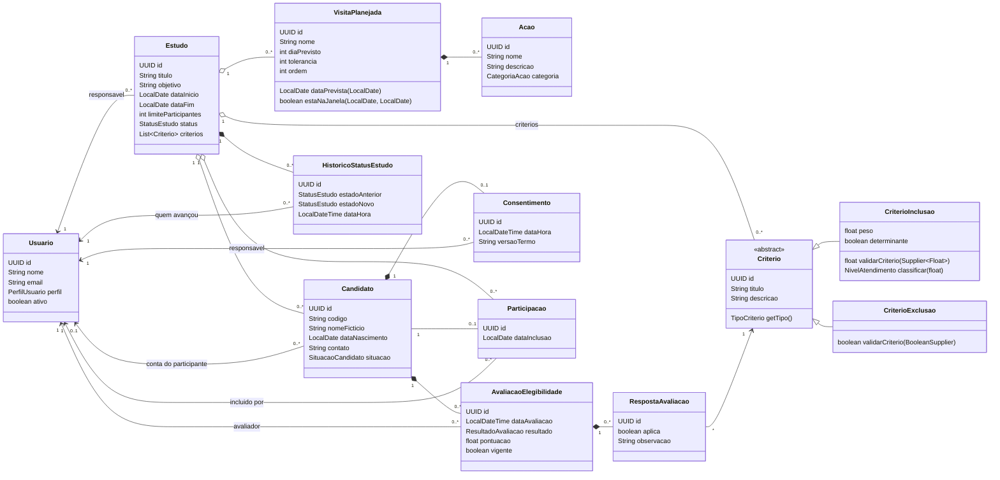
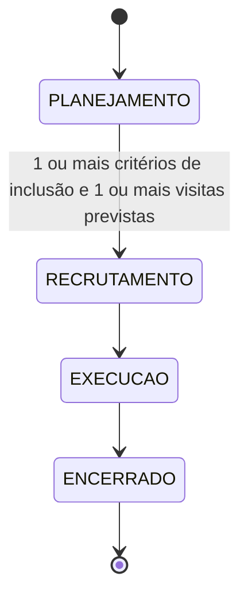
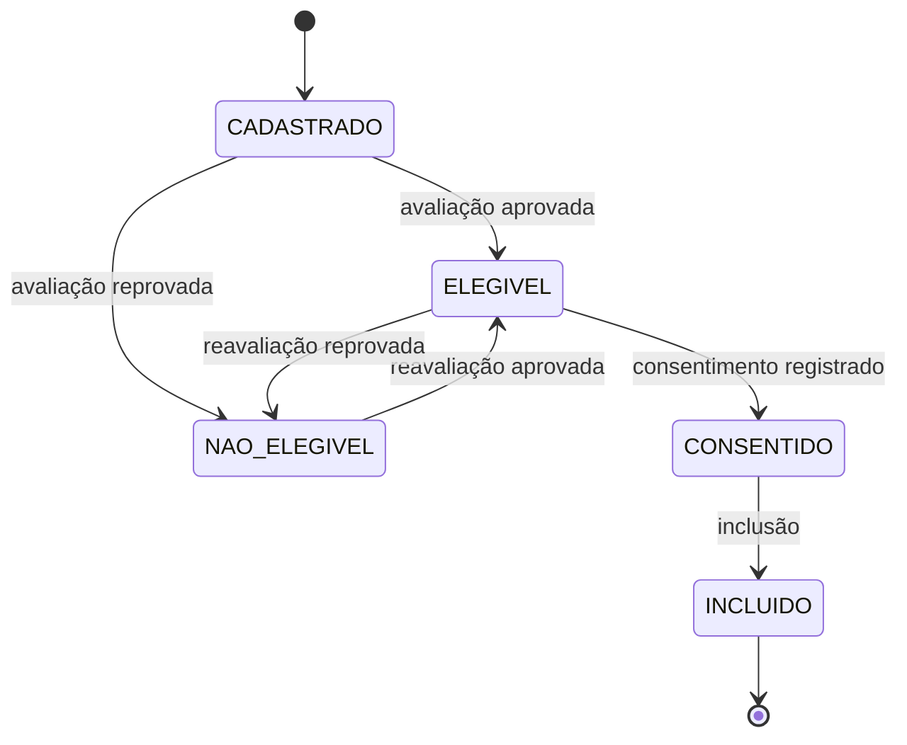

# Modelo de domínio da Sprint 2 (T36)

> Diagrama de classes, matriz de estados, pré-condições e regras de negócio do recrutamento (RF05 a RF11), **como estão implementados** no backend. É o produto da T36 e a base do diagrama atualizado da T69. Código em `backend/ClinicalStudyPB/src/main/java/UEPB/ESWII/ClinicalStudyPB/domain`; migrations `V4` e `V5`.

## 1. Diagrama de classes

Regras de domínio puras, sem banco nem Spring: `domain/regra/RegraElegibilidade` (elegibilidade) e `domain/regra/MaquinaEstadosEstudo` (estados do estudo).

### Entidades do planejamento e seus nomes no código

| Planejamento (T36) | Código | Tabela | Campos |
|---|---|---|---|
| Criterion | `Criterio` (abstrata), `CriterioInclusao`, `CriterioExclusao` | `criterios` (tabela única, coluna `tipo`) | estudo, tipo, título, descrição; inclusão: peso e determinante |
| PlannedVisit | `VisitaPlanejada` | `visitas_planejadas` | estudo, nome, dia previsto (contado da inclusão), tolerância em dias, ordem |
| Activity | `Acao` | `acoes` | visita, nome, descrição, categoria |
| Candidate | `Candidato` | `candidatos` | estudo, código gerado, nome fictício, data de nascimento, contato opcional, usuário opcional, situação |
| EligibilityEvaluation | `AvaliacaoElegibilidade` | `avaliacoes_elegibilidade` | candidato, data, avaliador, resultado, pontuação, vigente |
| EligibilityAnswer | `RespostaAvaliacao` | `respostas_avaliacao` | avaliação, critério, se aplica, observação |
| Consent | `Consentimento` | `consentimentos` | candidato (único), data e hora, responsável, versão do termo |
| Participation | `Participacao` | `participacoes` | candidato (único), estudo, data de inclusão, quem incluiu |
| study_status_history | `HistoricoStatusEstudo` | `historico_status_estudo` | estudo, estado anterior, novo estado, usuário, data e hora |

Diferenças dos nomes do planejamento: as tabelas seguem o português já usado na Sprint 1 (`usuarios`, `estudos`). Os critérios ficam em uma tabela só (herança de tabela única), e a `ordem` do critério do planejamento não foi criada (os critérios saem ordenados por título).

## 2. Matriz de transição de estados do estudo

Só avança, um estado por vez. Das 16 combinações de origem e destino, apenas 3 são válidas (✔).

| origem \ destino | PLANEJAMENTO | RECRUTAMENTO | EXECUCAO | ENCERRADO |
|---|:---:|:---:|:---:|:---:|
| **PLANEJAMENTO** | ✘ | ✔ (com pré-condições) | ✘ | ✘ |
| **RECRUTAMENTO** | ✘ | ✘ | ✔ | ✘ |
| **EXECUCAO** | ✘ | ✘ | ✘ | ✔ |
| **ENCERRADO** | ✘ | ✘ | ✘ | ✘ |

Só o pesquisador avança (`POST /api/estudos/{id}/transicoes`). Cada avanço grava estado anterior, novo estado, usuário e data em `historico_status_estudo`. Códigos de erro (HTTP 409): `TRANSICAO_ESTADO_INVALIDA`, `ESTUDO_SEM_CRITERIO_INCLUSAO`, `ESTUDO_SEM_VISITA_PREVISTA`.

## 3. Pré-condições

### Sair de planejamento

| # | Pré-condição | Código do erro |
|---|---|---|
| 1 | O destino é o estado seguinte (RECRUTAMENTO) | `TRANSICAO_ESTADO_INVALIDA` |
| 2 | Ao menos um critério de **inclusão** cadastrado | `ESTUDO_SEM_CRITERIO_INCLUSAO` |
| 3 | Ao menos uma **visita prevista** cadastrada | `ESTUDO_SEM_VISITA_PREVISTA` |

### Incluir um participante

Verificadas nesta ordem, em uma transação com o estudo bloqueado para escrita:

| # | Pré-condição | Resposta |
|---|---|---|
| 1 | Estudo em recrutamento | 409 `ESTUDO_FORA_DE_RECRUTAMENTO` |
| 2 | Candidato pertence ao estudo | 404 |
| 3 | Candidato ainda não incluído | 409 `CANDIDATO_JA_INCLUIDO` |
| 4 | Avaliação vigente com resultado aprovado | 409 `CANDIDATO_NAO_ELEGIVEL` |
| 5 | Consentimento registrado | 409 `CONSENTIMENTO_AUSENTE` |
| 6 | Vaga disponível (incluídos menores que o limite) | 409 `VAGAS_ESGOTADAS` |

### Situação do candidato

O consentimento pode vir antes da avaliação: aprovado e já consentido o candidato vai direto a `CONSENTIDO`. `EM_AVALIACAO` existe no enum, mas a API avalia todos os critérios de uma vez e não o usa.

## 4. As nove regras de negócio da Sprint 2

O plano da Sprint pede que o PO (I2) confirme ou corrija estas regras na daily. **As respostas do PO ainda não estão registradas neste repositório**: a coluna "Situação" mostra apenas o que o código implementa hoje. Se o PO mudar alguma, mudam o backend, as telas e os testes das tasks citadas.

| # | Regra | Implementada em | Situação |
|---|---|---|---|
| 1 | Critérios e visitas só mudam com o estudo em planejamento; depois ficam somente leitura | `CriterioService`, `VisitaService`; telas somente leitura | Implementada; **confirmação do PO pendente** |
| 2 | Estados só avançam, um de cada vez; sair de planejamento exige critério de inclusão e visita; só o pesquisador avança; cada mudança registra usuário e data | `MaquinaEstadosEstudo`, `EstudoTransicaoService`, `EstudoTransicaoController` | Implementada; **confirmação do PO pendente**. Ressalva: `PUT /api/estudos/{id}` ainda aceita qualquer `status` (ver o mapeamento das tasks) |
| 3 | Candidato só com o estudo em recrutamento; código gerado; dados fictícios; mesmo nome e nascimento não repete | `CandidatoService` | Implementada; **confirmação do PO pendente** |
| 4 | Avaliação responde a todos os critérios; elegível = inclusões determinantes atendidas e nenhuma exclusão satisfeita; a nova avaliação vale e a anterior fica no histórico | `RegraElegibilidade`, `AvaliacaoService` | Implementada; **confirmação do PO pendente**. Ressalva: só critérios **determinantes** reprovam (o plano diz "todos os de inclusão") |
| 5 | Consentimento independe da avaliação; a inclusão exige os dois | `ConsentimentoService`, `ParticipacaoService` | Implementada; **confirmação do PO pendente** |
| 6 | Inclusão só com estudo em recrutamento, candidato elegível, consentimento e vaga; checagem em transação com bloqueio | `ParticipacaoService` (`buscarComBloqueio`) | Implementada; **confirmação do PO pendente**. Falta teste de concorrência com várias threads (T62) |
| 7 | Permissões: pesquisador escreve RF05 a RF07 e lê candidatos; coordenador escreve RF08 a RF11 e lê o resto; administrador fora | `@PreAuthorize` com `security/Permissoes`; telas por perfil | Implementada; **confirmação do PO pendente** |
| 8 | Campo opcional de usuário participante no candidato; conta fica para a Sprint 3 | `Candidato.usuario` | Implementada; **confirmação do PO pendente** |
| 9 | Erros: 400 validação, 403 perfil, 404 inexistente, 409 regra violada com código | `ApiExceptionHandler`, `ConflitoRegraException` | Implementada (a lista de erros por campo não existe: um campo por resposta) |

Para fechar a T36 falta, fora do código: apresentar na daily, registrar as respostas do PO e aprovar este documento em Pull Request por I3 ou I4.
