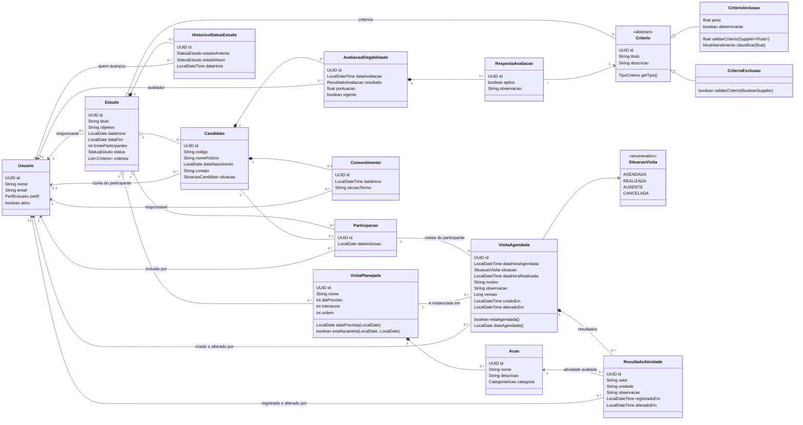
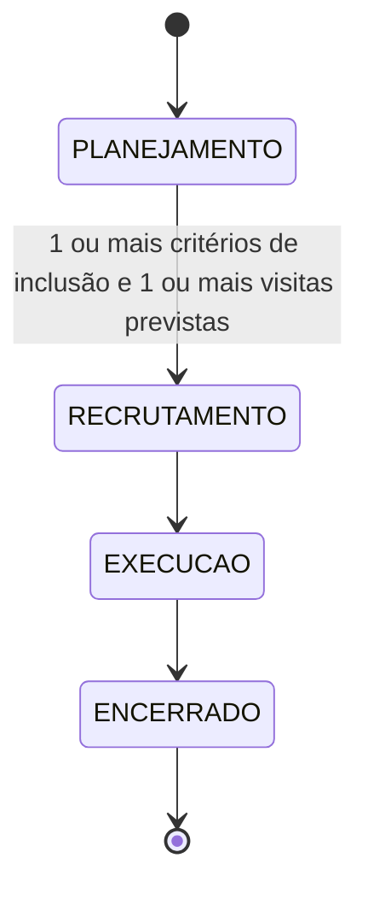
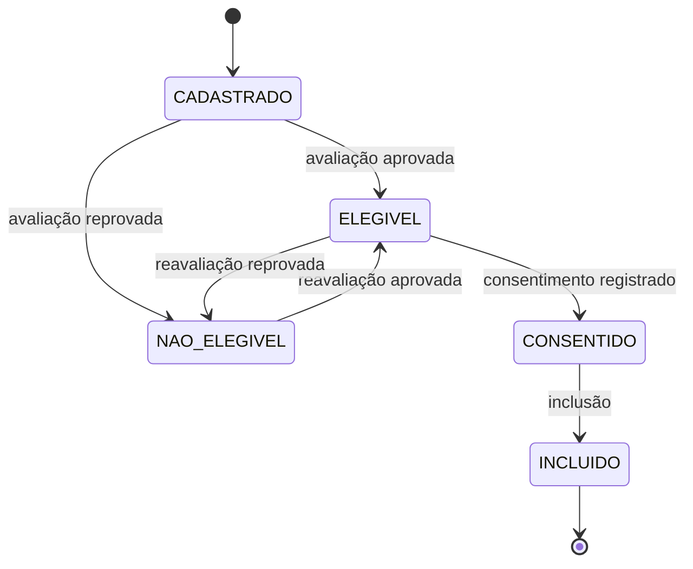
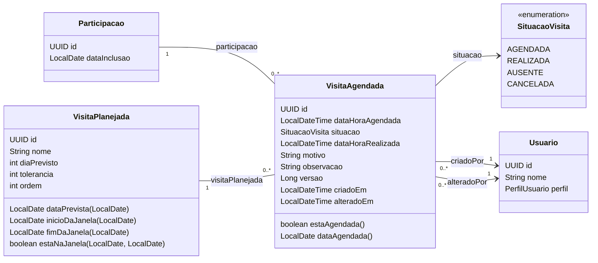
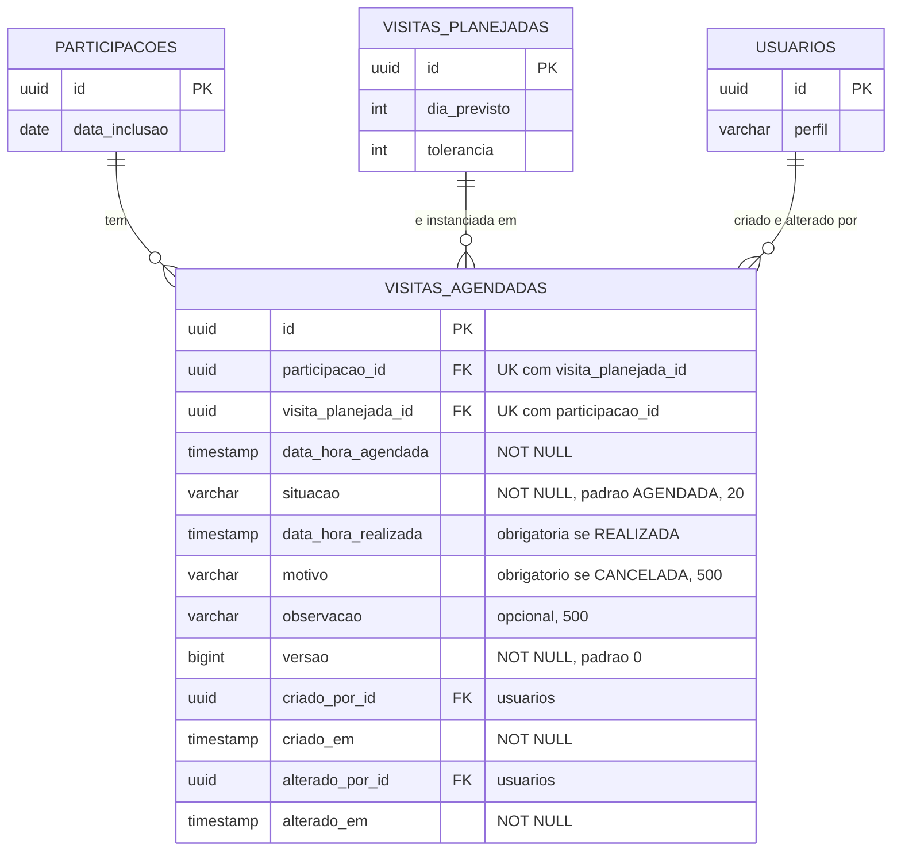
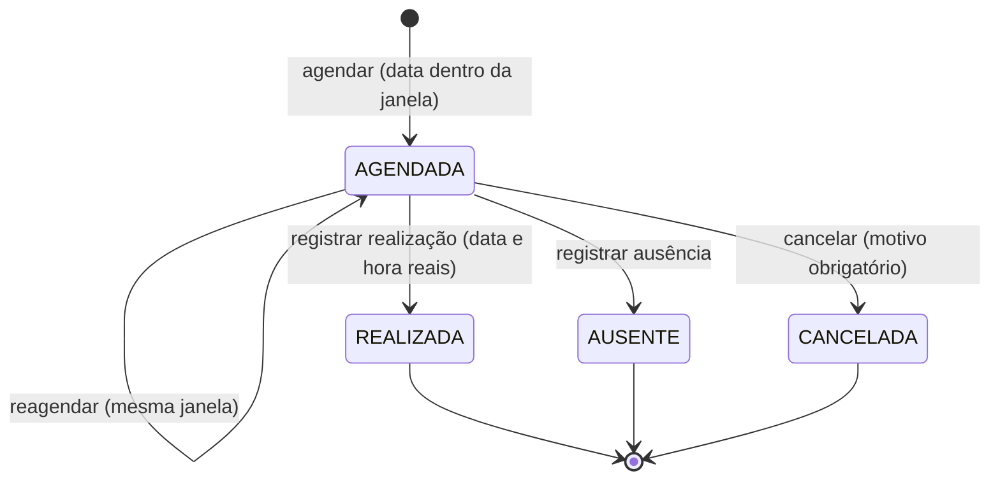
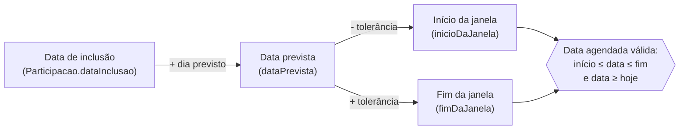
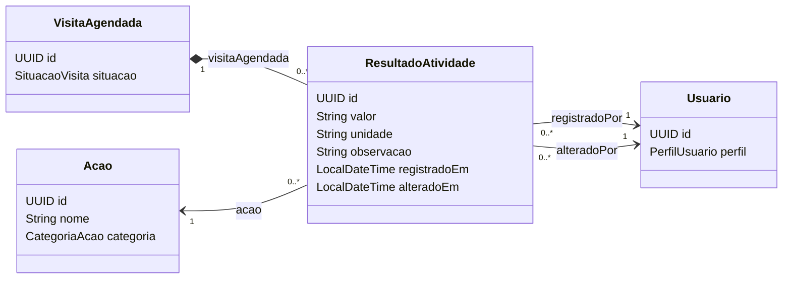
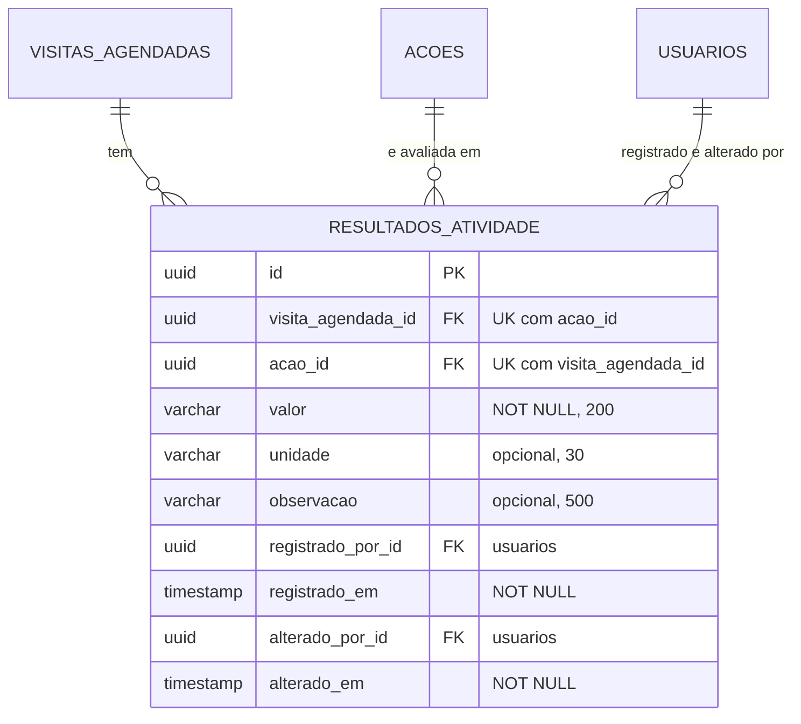

# Modelo de domínio das Sprints 2 e 3 (T36, T73 e T87)

> Diagrama de classes, matriz de estados, pré-condições e regras de negócio do recrutamento (RF05 a RF11), **como estão implementados** no backend. É o produto da T36 e a base do diagrama atualizado da T69. Código em `backend/ClinicalStudyPB/src/main/java/UEPB/ESWII/ClinicalStudyPB/domain`; migrations `V4` e `V5`. A **seção 5** acrescenta a **visita agendada** da Sprint 3 (T73, migration `V6_19_1`): é o diagrama de projeto dessa task, a ser mantido conforme o código for implementado. A **seção 6** acrescenta o **resultado das avaliações** (T87, migration `V6_21_1`).

## 1. Diagrama de classes

Regras de domínio puras, sem banco nem Spring: `domain/regra/RegraElegibilidade` (elegibilidade) e `domain/regra/MaquinaEstadosEstudo` (estados do estudo).

### Entidades do planejamento e seus nomes no código

| Planejamento (T36) | Código | Tabela | Campos |
|---|---|---|---|
| Criterion | `Criterio` (abstrata), `CriterioInclusao`, `CriterioExclusao` | `criterios` (tabela única, coluna `tipo`) | estudo, tipo, título, descrição; inclusão: peso e determinante |
| PlannedVisit | `VisitaPlanejada` | `visitas_planejadas` | estudo, nome, dia previsto (contado da inclusão), tolerância em dias, ordem |
| Activity | `Acao` | `acoes` | visita, nome, descrição, categoria |
| Candidate | `Candidato` | `candidatos` | estudo, código gerado, nome fictício, data de nascimento, contato opcional, usuário opcional, situação |
| EligibilityEvaluation | `AvaliacaoElegibilidade` | `avaliacoes_elegibilidade` | candidato, data, avaliador, resultado, pontuação, vigente |
| EligibilityAnswer | `RespostaAvaliacao` | `respostas_avaliacao` | avaliação, critério, se aplica, observação |
| Consent | `Consentimento` | `consentimentos` | candidato (único), data e hora, responsável, versão do termo |
| Participation | `Participacao` | `participacoes` | candidato (único), estudo, data de inclusão, quem incluiu |
| study_status_history | `HistoricoStatusEstudo` | `historico_status_estudo` | estudo, estado anterior, novo estado, usuário, data e hora |
| ScheduledVisit (Sprint 3, T73) | `VisitaAgendada` | `visitas_agendadas` | participação, visita prevista, data e hora agendadas, situação, data e hora reais, motivo, observação, versão, quem criou e alterou e quando |
| EvaluationResult (Sprint 3, T87) | `ResultadoAtividade` | `resultados_atividade` | visita agendada, atividade, valor (texto curto), unidade, observação, quem registrou e alterou e quando |

Diferenças dos nomes do planejamento: as tabelas seguem o português já usado na Sprint 1 (`usuarios`, `estudos`). Os critérios ficam em uma tabela só (herança de tabela única), e a `ordem` do critério do planejamento não foi criada (os critérios saem ordenados por título).

## 2. Matriz de transição de estados do estudo

Só avança, um estado por vez. Das 16 combinações de origem e destino, apenas 3 são válidas (✔).

| origem \ destino | PLANEJAMENTO | RECRUTAMENTO | EXECUCAO | ENCERRADO |
|---|:---:|:---:|:---:|:---:|
| **PLANEJAMENTO** | ✘ | ✔ (com pré-condições) | ✘ | ✘ |
| **RECRUTAMENTO** | ✘ | ✘ | ✔ | ✘ |
| **EXECUCAO** | ✘ | ✘ | ✘ | ✔ |
| **ENCERRADO** | ✘ | ✘ | ✘ | ✘ |

Só o pesquisador avança (`POST /api/estudos/{id}/transicoes`). Cada avanço grava estado anterior, novo estado, usuário e data em `historico_status_estudo`. Códigos de erro (HTTP 409): `TRANSICAO_ESTADO_INVALIDA`, `ESTUDO_SEM_CRITERIO_INCLUSAO`, `ESTUDO_SEM_VISITA_PREVISTA`.

## 3. Pré-condições

### Sair de planejamento

| # | Pré-condição | Código do erro |
|---|---|---|
| 1 | O destino é o estado seguinte (RECRUTAMENTO) | `TRANSICAO_ESTADO_INVALIDA` |
| 2 | Ao menos um critério de **inclusão** cadastrado | `ESTUDO_SEM_CRITERIO_INCLUSAO` |
| 3 | Ao menos uma **visita prevista** cadastrada | `ESTUDO_SEM_VISITA_PREVISTA` |

### Incluir um participante

Verificadas nesta ordem, em uma transação com o estudo bloqueado para escrita:

| # | Pré-condição | Resposta |
|---|---|---|
| 1 | Estudo em recrutamento | 409 `ESTUDO_FORA_DE_RECRUTAMENTO` |
| 2 | Candidato pertence ao estudo | 404 |
| 3 | Candidato ainda não incluído | 409 `CANDIDATO_JA_INCLUIDO` |
| 4 | Avaliação vigente com resultado aprovado | 409 `CANDIDATO_NAO_ELEGIVEL` |
| 5 | Consentimento registrado | 409 `CONSENTIMENTO_AUSENTE` |
| 6 | Vaga disponível (incluídos menores que o limite) | 409 `VAGAS_ESGOTADAS` |

### Situação do candidato

O consentimento pode vir antes da avaliação: aprovado e já consentido o candidato vai direto a `CONSENTIDO`. `EM_AVALIACAO` existe no enum, mas a API avalia todos os critérios de uma vez e não o usa.

## 4. As nove regras de negócio da Sprint 2

As regras abaixo foram definidas pela especificação do projeto que a equipe forneceu (o arquivo "coisas a afazer esw.txt") e estão implementadas e testadas. O plano da Sprint prevê confirmá-las com o PO (I2) na daily; se ele pedir mudança em alguma, mudam o backend, as telas e os testes das tasks citadas.

| # | Regra | Implementada em | Situação |
|---|---|---|---|
| 1 | Critérios e visitas só mudam com o estudo em planejamento; depois ficam somente leitura | `CriterioService`, `VisitaService`; telas somente leitura | Implementada; **definida pela especificação do projeto** |
| 2 | Estados só avançam, um de cada vez; sair de planejamento exige critério de inclusão e visita; só o pesquisador avança; cada mudança registra usuário e data | `MaquinaEstadosEstudo`, `EstudoTransicaoService`, `EstudoTransicaoController` | Implementada; **definida pela especificação do projeto**. O estado só muda por essa transição: `POST /api/estudos` só cria em planejamento e `PUT /api/estudos/{id}` não aceita outro estado (409) |
| 3 | Candidato só com o estudo em recrutamento; código gerado; dados fictícios; mesmo nome e nascimento não repete | `CandidatoService` | Implementada; **definida pela especificação do projeto** |
| 4 | Avaliação responde a todos os critérios; elegível = inclusões determinantes atendidas e nenhuma exclusão satisfeita; a nova avaliação vale e a anterior fica no histórico | `RegraElegibilidade`, `AvaliacaoService` | Implementada; **definida pela especificação do projeto**. Ressalva: só critérios **determinantes** reprovam (o plano diz "todos os de inclusão") |
| 5 | Consentimento independe da avaliação; a inclusão exige os dois | `ConsentimentoService`, `ParticipacaoService` | Implementada; **definida pela especificação do projeto** |
| 6 | Inclusão só com estudo em recrutamento, candidato elegível, consentimento e vaga; checagem em transação com bloqueio | `ParticipacaoService` (`buscarComBloqueio`) | Implementada; **definida pela especificação do projeto**. Falta teste de concorrência com várias threads (T62) |
| 7 | Permissões: pesquisador escreve RF05 a RF07 e lê candidatos; coordenador escreve RF08 a RF11 e lê o resto; administrador fora | `@PreAuthorize` com `security/Permissoes`; telas por perfil | Implementada; **definida pela especificação do projeto** |
| 8 | Campo opcional de usuário participante no candidato; conta fica para a Sprint 3 | `Candidato.usuario` | Implementada; **definida pela especificação do projeto** |
| 9 | Erros: 400 validação, 403 perfil, 404 inexistente, 409 regra violada com código | `ApiExceptionHandler`, `ConflitoRegraException` | Implementada (a lista de erros por campo não existe: um campo por resposta) |

**Situação da T36 (02/11/2026):** o modelo está em código, testado e documentado, e a equipe decidiu seguir a especificação fornecida como definição das regras. A aprovação deste documento em Pull Request por I3 ou I4 continua sendo o registro formal.

## 5. Visita agendada (Sprint 3 · T73)

A **visita prevista** (`VisitaPlanejada`) é o molde do protocolo, igual para todos os participantes e medido em dias a partir da inclusão. A **visita agendada** (`VisitaAgendada`) é a visita **real** de uma pessoa: nasce quando o coordenador marca uma data para aquele participante e guarda o que aconteceu com ela. Por isso o modelo liga as duas pontas: **uma participação** e **uma visita prevista**.

### 5.1 Classes e relacionamentos

Regras de leitura:

- **Uma visita agendada por visita prevista e por participante.** A dupla (participação, visita prevista) é única; por isso uma visita **cancelada não pode ser agendada de novo**.
- A entidade só guarda dados. A conta da janela (`inicioDaJanela`, `fimDaJanela`, `estaNaJanela`) fica em `VisitaPlanejada`, que já existe desde a Sprint 2; as regras de agendar e reagendar são do `AgendamentoService` (T75) e as de desfecho, da `MaquinaEstadosVisita` (T80).
- `versao` é o controle de versão otimista (`@Version`): dois desfechos simultâneos para a mesma visita não podem dar certo ao mesmo tempo (T81).
- `criadoPor` e `alteradoPor` apontam para `Usuario` (o coordenador que agendou e o último que alterou); as datas `criadoEm` e `alteradoEm` acompanham.

### 5.2 Tabela `visitas_agendadas` (migration `V6_19_1__create_scheduled_visits.sql`)

| Constraint ou índice | O que garante |
|---|---|
| `pk_visitas_agendadas` | Chave primária (`id`) |
| `uk_visitas_agendadas_participacao_visita` | Um agendamento por visita prevista e por participante (regra 2) |
| `chk_visitas_agendadas_situacao` | A situação é uma de `AGENDADA`, `REALIZADA`, `AUSENTE`, `CANCELADA` |
| `chk_visitas_agendadas_campos_por_situacao` | `REALIZADA` exige `data_hora_realizada` e `CANCELADA` exige `motivo` (a regra de negócio fica no serviço; o banco é a última barreira) |
| `idx_visitas_agendadas_participacao` | Consultas por participante (ficha, histórico, app) |
| `idx_visitas_agendadas_data_situacao` | Agenda do estudo por período e situação |
| Chaves estrangeiras | Para `participacoes`, `visitas_planejadas` e, duas vezes, `usuarios`; nenhuma `ON DELETE CASCADE` |

### 5.3 Ciclo de vida da situação

A visita **nasce `AGENDADA`**; reagendar só troca a data. `REALIZADA`, `AUSENTE` e `CANCELADA` são **estados finais**: não há volta. A tabela guarda os quatro valores desde a T73; as transições são validadas pela `MaquinaEstadosVisita` (T80) e aplicadas pelo serviço de desfecho (T81).

Das 16 combinações de origem e destino, só 3 transições são válidas (todas a partir de `AGENDADA`), como na máquina de estados do estudo.

### 5.4 De onde vem a janela da data agendada

O agendamento só aceita uma data **de hoje em diante** e **dentro da janela** da visita prevista, calculada a partir da data de inclusão do participante (o "dia 0" da `Participacao`).

Exemplo, com o participante P1 do estudo de demonstração (incluído há 20 dias, **D** é a data de hoje) e a visita prevista "Retorno 30 dias" (dia previsto 30, tolerância 5):

| Etapa | Cálculo | Data |
|---|---|---|
| Inclusão | `dataInclusao` | D − 20 |
| Data prevista | inclusão + 30 dias | **D + 10** |
| Início da janela | prevista − 5 dias | D + 5 |
| Fim da janela | prevista + 5 dias | D + 15 |

Qualquer data de D + 5 a D + 15 é aceita; D + 4 e D + 16 recebem `409 DATA_FORA_DA_JANELA`.

## 6. Resultados das avaliações (Sprint 3 · T87)

O **resultado** (`ResultadoAtividade`) guarda o valor **fictício** de uma atividade (`Acao`) de uma visita agendada (`VisitaAgendada`): por exemplo, "120/80 mmHg" para "Aferir pressão arterial". Há **um resultado por atividade e por visita agendada**; editar troca o valor e atualiza quem alterou e quando, sem criar outra linha. Os resultados são fictícios (LGPD): nenhum dado real de pessoa é armazenado.

### 6.1 Classes e relacionamentos

Regras de leitura:

- A entidade só guarda dados. A regra 4 (resultado só para visita `REALIZADA` e só para atividade `AVALIACAO_CLINICA` da visita prevista, estudo não encerrado, valor não vazio) é do `ResultadoAtividadeService` (T89).
- `valor` é texto curto livre (até 200 caracteres); não há tipos numéricos nem faixas de referência. `unidade` (até 30) e `observacao` (até 500) são opcionais.
- `registradoPor` e `registradoEm` não mudam depois do primeiro registro; `alteradoPor` e `alteradoEm` acompanham a última edição.

### 6.2 Tabela `resultados_atividade` (migration `V6_21_1__create_evaluation_results.sql`)

| Constraint ou índice | O que garante |
|---|---|
| `pk_resultados_atividade` | Chave primária (`id`) |
| `uk_resultados_atividade_visita_acao` | Um resultado por atividade e por visita agendada (regra 4) |
| `idx_resultados_atividade_visita_agendada` | Consulta dos resultados de uma visita (tela da T91 e histórico da T96) |
| Chaves estrangeiras | Para `visitas_agendadas`, `acoes` e, duas vezes, `usuarios`; todas `ON DELETE RESTRICT`, nenhuma cascata |

