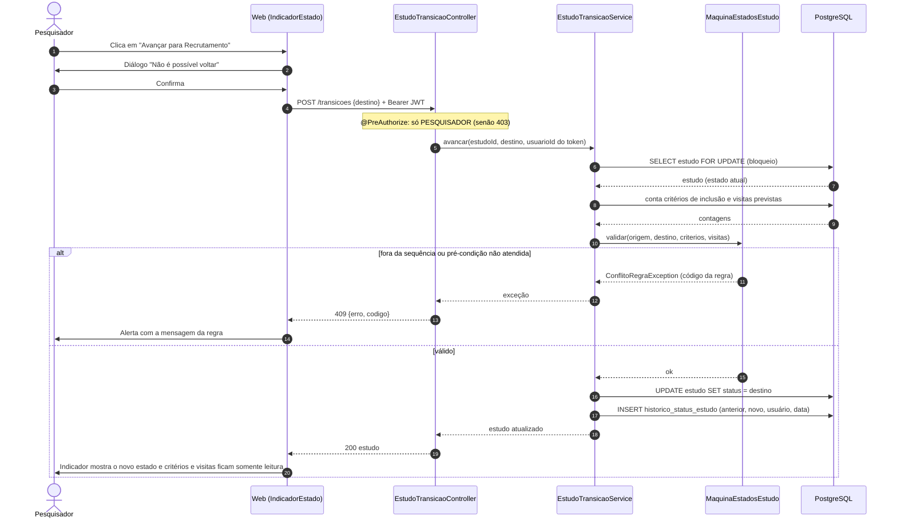

# Sequência: avançar o estado do estudo (T69 / RF07)

`POST /api/estudos/{estudoId}/transicoes`, só para o pesquisador. A autorização acontece antes do controller; as regras estão em `MaquinaEstadosEstudo` (pura) e a consulta e a gravação em `EstudoTransicaoService`.

Como o estudo é bloqueado na leitura, dois avanços simultâneos são atendidos um de cada vez: o segundo encontra o novo estado e é recusado como `TRANSICAO_ESTADO_INVALIDA`.
