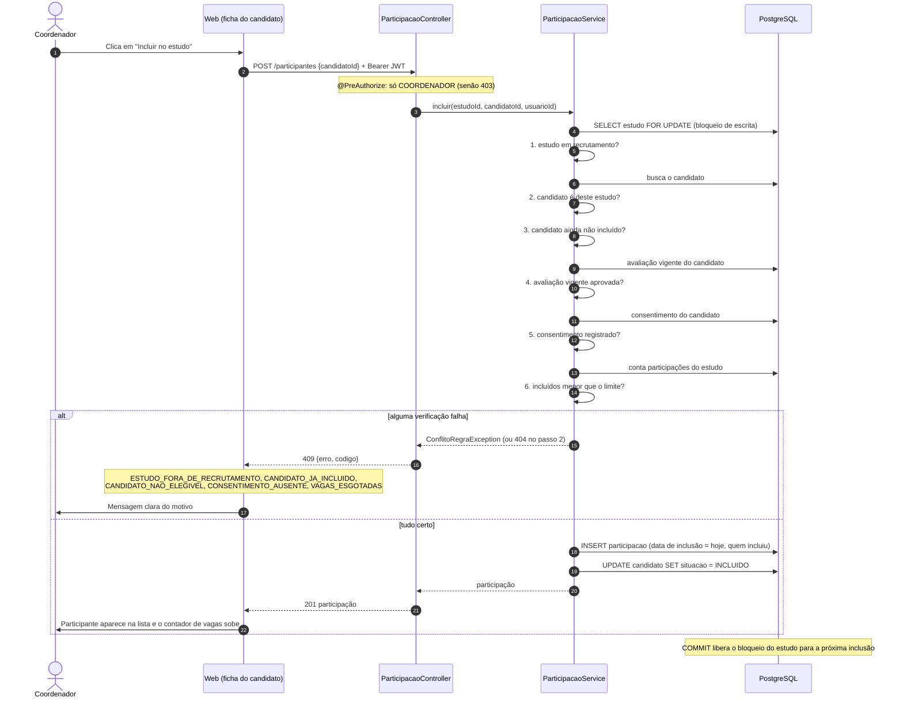

# Sequência: incluir participante (T69 / RF11)

`POST /api/estudos/{estudoId}/participantes`, só para o coordenador. Tudo em uma única transação, com o estudo bloqueado para escrita: inclusões simultâneas são atendidas uma por vez e o total nunca passa do limite de vagas. Cada verificação que falha devolve 409 com um código próprio e **nenhuma participação é gravada**.

A data de inclusão é o "dia 0": somada ao dia previsto de cada `VisitaPlanejada` dá a data real das visitas daquele participante (`VisitaPlanejada.dataPrevista`), usada pelo aplicativo mobile nas próximas Sprints.
