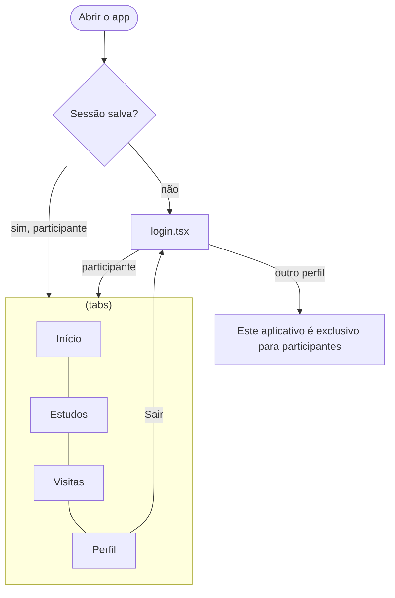

# Implementação do aplicativo mobile — T12 (e parte de código da T34)

> Responsável: I7 · PBI-03 (T12) e PBI-08 (T34) · Sprint 1
>
> Base: [prototipos-mobile.md](prototipos-mobile.md) (telas M01 a M11 e navegação), [arquitetura.md](arquitetura.md) (seção 8, estrutura do mobile) e matriz RBAC (o app atende só o **Participante**).

## 1. O que existe

| Item | Situação |
|---|---|
| Projeto Expo SDK 58 + TypeScript | ✅ |
| Navegação com Expo Router (login fora das abas; 4 abas com sessão) | ✅ |
| Login real na API (`/api/auth/login` + `/api/auth/me`), só para participante | ✅ |
| Sessão salva com `expo-secure-store` e restaurada ao abrir o app | ✅ |
| Logout (aba Perfil) | ✅ |
| Conteúdo de estudos e visitas (RF17 a RF20) | ⏳ próximas sprints: as telas mostram onde cada requisito vai entrar |

**Correção da pasta:** antes desta task, `mobile/ClinicalStudyPB` estava registrada no Git como submódulo, mas sem o arquivo `.gitmodules`, então chegava vazia para quem clonava. A referência foi removida e o projeto foi criado como pasta normal.

## 2. Estrutura

```text
mobile/ClinicalStudyPB/
├── app.json                  # nome, scheme "clinicalstudypb", plugins expo-router e expo-secure-store
├── package.json              # "main": "expo-router/entry"; scripts com --port 8082
├── tsconfig.json             # alias @/* → src/*
├── .env.example              # EXPO_PUBLIC_API_URL
├── AGENTS.md                 # orientações do template Expo para assistentes de código
└── src/
    ├── app/                  # Rotas (cada arquivo é uma tela)
    │   ├── _layout.tsx       # SessaoProvider + Stack com Stack.Protected
    │   ├── login.tsx         # M01 Login
    │   └── (tabs)/
    │       ├── _layout.tsx   # Tab bar: Início · Estudos · Visitas · Perfil
    │       ├── index.tsx     # M02 Início
    │       ├── estudos.tsx   # M03 Meus estudos (RF17 — próximas sprints)
    │       ├── visitas.tsx   # M05/M06 Visitas (RF18, RF19 — próximas sprints)
    │       └── perfil.tsx    # M11 Perfil + Sair
    ├── api/
    │   ├── cliente.ts        # fetch com token, erros {"erro": "..."} e chamadas de autenticação
    │   └── armazenamento.ts  # SecureStore no celular; localStorage no navegador
    ├── components/
    │   ├── tema.ts           # cores e espaçamentos (os mesmos da web)
    │   └── ui.tsx            # Tela, Cartao, Botao, EmBreve e estilos
    └── contexts/
        └── sessao.tsx        # SessaoProvider e useSessao
```

A arquitetura previa uma pasta `navigation/`. Com o Expo Router, a navegação fica nos arquivos `_layout.tsx` dentro de `src/app/`, que é o padrão do SDK 58. As demais pastas (`api/`, `components/`, `contexts/`) seguem a arquitetura; `screens/` virou `app/`.

## 3. Navegação



O `_layout.tsx` raiz usa `Stack.Protected guard={!usuario}` para o login e `guard={!!usuario}` para as abas. Quando o usuário sai, o Expo Router redireciona sozinho para a tela permitida.

## 4. Como rodar

1. Suba o backend (`backend/ClinicalStudyPB`, porta 8081). Veja o README, seção 5.
2. No mobile:
   ```bash
   cd mobile/ClinicalStudyPB
   npm install
   npm start
   ```
3. Abra no dispositivo:

| Onde | Como | `EXPO_PUBLIC_API_URL` |
|---|---|---|
| Celular com Expo Go | Ler o QR code (mesma rede Wi-Fi) | `http://<IP-da-máquina>:8081` |
| Emulador Android | Tecla `a` no terminal do Expo | `http://10.0.2.2:8081` |
| Navegador | Tecla `w` ou `npm run web` | `http://localhost:8081` (padrão) |

Para mudar a URL, copie `.env.example` para `.env.local` e reinicie o Expo.

4. Entre com `participante@clinicalstudy.test` / `senha-de-teste` (usuário fictício do seed).

**Porta 8082:** o Metro usa a 8081 por padrão, que já é a porta do backend. Os scripts do `package.json` passam `--port 8082`, e o backend libera CORS para `http://localhost:8082` para o app funcionar no navegador.

## 5. Verificações

| Comando | O que faz |
|---|---|
| `npm run lint` | ESLint (configuração `eslint-config-expo`) |
| `npm run typecheck` | `tsc --noEmit` |

Os dois rodam na CI (`.github/workflows/ci.yml`, job **Mobile**).

**Teste manual em 26/10/2026, versão web do app (backend com H2):**
- Sem sessão, o app abre no login.
- O pesquisador é recusado com a mensagem de app exclusivo para participantes.
- O participante entra e vê as abas com o próprio nome.
- "Sair" no Perfil volta ao login e apaga o token.

Não foi testado em emulador nem em celular físico.

## 6. Próximos passos (sprints seguintes)

- RF17 a RF20: endpoints do participante no backend (estudos em que está incluído, visitas, confirmação, reagendamento e retirada) e conteúdo das abas, seguindo as telas M03 a M10 de [prototipos-mobile.md](prototipos-mobile.md).
- Testes de componentes (ex.: Jest + React Native Testing Library) e um fluxo E2E (ex.: Maestro), como pede a especificação.
- Ícones das abas: hoje são símbolos de texto; trocar por `@expo/vector-icons` ou `expo-symbols` se a equipe quiser.
