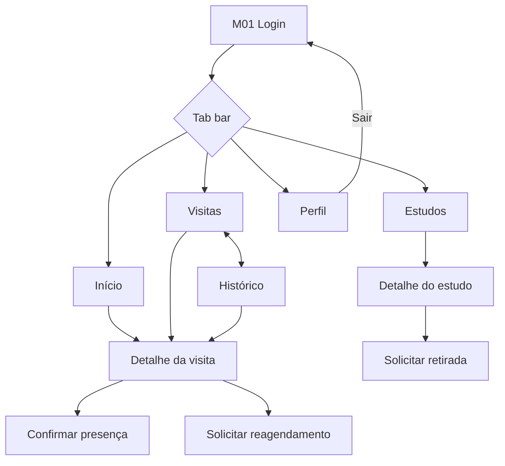

# Requisitos dos protótipos mobile — T33 e T34

> Responsável: I7 · PBI-08 (Protótipos navegáveis das interfaces) · Sprint 1
>
> - **T33** — Criar protótipos navegáveis das telas do participante no Figma (5h)
> - **T34** — Preparar fluxo de navegação mobile para demonstração (3h)
>
> Base: perfil **Participante** e módulo E da [especificação](especificacao-projeto.md) (RF17 a RF20), mais RF02/RF03 (autenticação e acesso por perfil). Telas e fluxos abaixo são uma proposta para validar com a equipe.
>
> **Status (26/10/2026):** a navegação da seção 4.1 já existe no app Expo (login, abas e logout) — ver [implementacao-mobile.md](implementacao-mobile.md). Faltam o arquivo do Figma (T33) e o fluxo navegável no Figma (T34).

## 1. Escopo e premissas

- O aplicativo mobile atende **somente o perfil Participante**. Pesquisador, coordenador e administrador usam a web.
- Na Sprint 1 o mobile é apenas **protótipo e navegação básica**. O login real e as funcionalidades completas ficam para sprints posteriores.
- Todos os dados são **fictícios**. Nenhum dado clínico real aparece nas telas.
- O sistema não faz diagnóstico nem decisão clínica: nenhuma tela deve sugerir isso.
- Dispositivo de referência: celular em retrato, **390 × 844 px** (frame "iPhone 14" ou equivalente do Figma).
- Os frames devem refletir o que será implementado em React Native + Expo (tab bar inferior, header, listas, botões).

## 2. Requisitos funcionais cobertos pelas telas

| RF   | Requisito                                      | Tela(s)                                                        |
| ---- | ---------------------------------------------- | -------------------------------------------------------------- |
| RF02 | Autenticação e encerramento de sessão          | Login; Perfil (Sair)                                           |
| RF03 | Restrição por perfil                           | Login com mensagem para perfis sem acesso ao app (opcional)    |
| RF17 | Consultar os estudos em que está incluído      | Meus estudos; Detalhe do estudo                                |
| RF18 | Próximas visitas e histórico de comparecimento | Visitas (abas Próximas / Histórico); Detalhe da visita         |
| RF19 | Confirmar presença ou solicitar reagendamento  | Detalhe da visita; Confirmar presença; Solicitar reagendamento |
| RF20 | Solicitar retirada voluntária do estudo        | Detalhe do estudo; Solicitar retirada                          |

## 3. Inventário de telas (T33)

### 3.1 Obrigatórias

| #   | Tela                             | Conteúdo mínimo                                                                                                     | Ações                                       |
| --- | -------------------------------- | ------------------------------------------------------------------------------------------------------------------- | ------------------------------------------- |
| M01 | **Login**                        | Logo/nome do sistema, campos e-mail e senha, botão Entrar, texto de aviso de dados fictícios                        | Entrar; mostrar/ocultar senha               |
| M02 | **Início (Home)**                | Saudação com nome, card da próxima visita, atalho para Meus estudos                                                 | Abrir próxima visita; abrir estudos         |
| M03 | **Meus estudos**                 | Lista de cards: título, status do estudo, data de inclusão                                                          | Abrir detalhe                               |
| M04 | **Detalhe do estudo**            | Título, objetivo, responsável, período, status da participação, lista de visitas previstas                          | Ver visitas; Solicitar retirada             |
| M05 | **Visitas — Próximas**           | Lista ordenada por data: data/hora, nome da visita, estudo, status (agendada, confirmada, reagendamento solicitado) | Abrir detalhe                               |
| M06 | **Visitas — Histórico**          | Lista de visitas passadas com status (realizada, ausente, cancelada) e resumo de comparecimento                     | Abrir detalhe                               |
| M07 | **Detalhe da visita**            | Data/hora, local, atividades previstas, status atual                                                                | Confirmar presença; Solicitar reagendamento |
| M08 | **Confirmar presença**           | Modal/tela de confirmação com resumo da visita                                                                      | Confirmar; Cancelar                         |
| M09 | **Solicitar reagendamento**      | Seleção de motivo, campo de observação, sugestão de nova data                                                       | Enviar solicitação; Cancelar                |
| M10 | **Solicitar retirada do estudo** | Aviso sobre o impacto, campo de motivo, confirmação explícita                                                       | Confirmar retirada; Voltar                  |
| M11 | **Perfil**                       | Nome, e-mail, perfil "Participante"                                                                                 | Sair (encerra a sessão)                     |

### 3.2 Estados e variações (para mostrar na demonstração)

| Tela                  | Estado a prototipar                                                |
| --------------------- | ------------------------------------------------------------------ |
| M01 Login             | Erro de credenciais inválidas; campo obrigatório vazio             |
| M03 Meus estudos      | Estado vazio ("Você ainda não está incluído em nenhum estudo")     |
| M05 Próximas          | Estado vazio ("Nenhuma visita agendada")                           |
| M07 Detalhe da visita | Visita já confirmada (botão de confirmar desabilitado)             |
| M08, M09, M10         | Mensagem de sucesso após a ação (toast ou tela de sucesso)         |
| M10 Retirada          | Estudo já com retirada solicitada (aviso "Solicitação em análise") |

### 3.3 Componentes reutilizáveis

Criar como componentes do Figma (com variantes quando fizer sentido), para as telas ficarem consistentes e para facilitar a implementação:

- Header com título e botão de voltar
- Tab bar inferior: **Início · Estudos · Visitas · Perfil**
- Card de estudo
- Card de visita
- Badge de status (agendada, confirmada, realizada, ausente, cancelada, reagendamento solicitado)
- Botões primário, secundário e destrutivo
- Campo de texto com estado de erro
- Modal de confirmação e toast de sucesso
- Estado vazio (ícone + texto)

### 3.4 Dados fictícios de apoio

Usar sempre os mesmos dados nas telas, para o fluxo parecer coerente:

| Item         | Exemplo                                                                                   |
| ------------ | ----------------------------------------------------------------------------------------- |
| Participante | Maria Souza — maria.souza@clinicalstudy.test                                              |
| Estudo 1     | "Estudo de Hipertensão Leve" — status: em execução                                        |
| Estudo 2     | "Estudo de Qualidade do Sono" — status: em recrutamento                                   |
| Visitas      | Triagem (realizada), Visita 1 (confirmada, 28/10 09:00), Visita 2 (agendada, 11/11 14:30) |
| Histórico    | 1 realizada, 1 ausente, 1 cancelada                                                       |

## 4. Navegação e fluxos (T34)

### 4.1 Estrutura de navegação

Padrão do React Native: **navegação em abas** (Início, Estudos, Visitas, Perfil) com **pilha** dentro de cada aba. A tela de login fica fora das abas.

### 4.2 Fluxos que o protótipo deve permitir percorrer

| Fluxo                                 | Caminho                                             | RF   |
| ------------------------------------- | --------------------------------------------------- | ---- |
| F1 — Entrar                           | M01 → M02                                           | RF02 |
| F2 — Ver meus estudos                 | M02/Tab Estudos → M03 → M04                         | RF17 |
| F3 — Ver próximas visitas e histórico | Tab Visitas → M05 ⇄ M06 → M07                       | RF18 |
| F4 — Confirmar presença               | M05 → M07 → M08 → sucesso → M05 (visita confirmada) | RF19 |
| F5 — Solicitar reagendamento          | M07 → M09 → sucesso → M07 (status atualizado)       | RF19 |
| F6 — Solicitar retirada               | M03 → M04 → M10 → sucesso → M04                     | RF20 |
| F7 — Sair                             | Tab Perfil → M11 → Sair → M01                       | RF02 |

### 4.3 Roteiro de demonstração (T34)

Sequência curta para a Sprint Review (3 a 5 minutos), seguindo a ordem dos fluxos:

1. Abrir o protótipo/app no **M01** e fazer login (F1).
2. Mostrar **Meus estudos** e abrir o detalhe de um estudo (F2).
3. Ir a **Visitas**, alternar entre Próximas e Histórico (F3).
4. Abrir uma visita e **confirmar presença** (F4).
5. Abrir outra visita e **solicitar reagendamento** (F5).
6. Voltar ao estudo e mostrar a **solicitação de retirada** até a tela de confirmação (F6).
7. **Sair** pelo Perfil (F7).

Incluir, se der tempo, um erro de login (M01) e um estado vazio (M03/M05) para mostrar tratamento de validação.

## 5. Requisitos do protótipo no Figma (T33)

- [ ] Arquivo único no Figma, nomeado **ClinicalStudyPB — Mobile (Participante)**.
- [ ] Páginas: **Fluxos**, **Telas**, **Componentes** e **Estilos** (cores, tipografia).
- [ ] Todos os frames M01 a M11 nomeados com o código e o nome (ex.: `M07 Detalhe da visita`).
- [ ] Estilos de cor e texto definidos como _styles/variables_, sem valores soltos.
- [ ] Componentes com variantes (botões, badges, cards).
- [ ] Conexões do modo **Prototype** cobrindo os fluxos F1 a F7, com transições coerentes (push para avançar, modal para confirmações).
- [ ] Ponto de partida do protótipo definido em **M01 Login**.
- [ ] Interações de erro e estados vazios prototipados (seção 3.2).
- [ ] Apenas dados fictícios (seção 3.4).
- [ ] Link de compartilhamento com permissão de **visualização** para a equipe e o professor.
- [ ] Link registrado no README (seção de documentos) e no item do Azure Boards.

## 6. Requisitos de T34 — fluxo de navegação mobile para demonstração

T34 prepara o que será mostrado e também a base da navegação no app.

**Entregas**

- [ ] Diagrama de navegação (seção 4.1) salvo em `docs/`, em imagem ou Mermaid.
- [ ] Roteiro de demonstração (seção 4.3) revisado pela equipe e anexado ao PBI.
- [ ] Fluxo percorrível no Figma em **modo apresentação**, sem dependência de backend.
- [ ] Navegação básica no app Expo com as telas como placeholders (opcional nesta Sprint, já que a T12 cobre a navegação básica): login → abas Início/Estudos/Visitas/Perfil.

**Critério de aceite (do PBI-08):** links dos protótipos navegáveis web e mobile disponíveis para revisão e demonstração.

## 7. Acessibilidade e usabilidade

- Alvos de toque de pelo menos **44 × 44 px**.
- Contraste de texto adequado (mínimo 4,5:1 para texto comum).
- Texto base legível no mobile (16 px ou mais) e hierarquia clara entre título, subtítulo e corpo.
- Ações destrutivas (retirada) sempre pedem **confirmação explícita** e usam botão destrutivo.
- Toda ação mostra um retorno visível (toast, tela de sucesso ou mudança de status).
- Linguagem simples, sem jargão clínico desnecessário.

## 8. Dependências e pontos a alinhar com a equipe

| Tema                       | Com quem            | Por quê                                                                         |
| -------------------------- | ------------------- | ------------------------------------------------------------------------------- |
| Campos de visita e estudo  | I3 (domínio)        | Garantir que os campos mostrados existem no modelo (local, atividades, status). |
| Status possíveis de visita | I3 / I2 (PO)        | Alinhar nomes: agendada, confirmada, realizada, ausente, cancelada.             |
| Paleta e identidade visual | I6 (protótipos web) | Manter cores e tipografia coerentes entre web e mobile.                         |
| Navegação no app           | I7 (T12)            | O mesmo desenho de abas e pilha vale para o Expo.                               |
| Tela de login              | I5 / I4             | O formulário e as mensagens de erro devem ser as mesmas da web.                 |
| Limite do mobile           | I2 (PO)             | Confirmar que na Sprint 1 é só protótipo, sem login real.                       |

## 9. Definição de pronto para T33 e T34

- [ ] Telas M01 a M11 prontas, com componentes reutilizáveis.
- [ ] Fluxos F1 a F7 navegáveis no Figma.
- [ ] Estados de erro, vazio e sucesso prototipados.
- [ ] Diagrama de navegação e roteiro de demonstração documentados.
- [ ] Link do protótipo compartilhado e registrado no README e no Azure Boards.
- [ ] Revisão feita por outro integrante (I1 revisa fluxos na T35).
