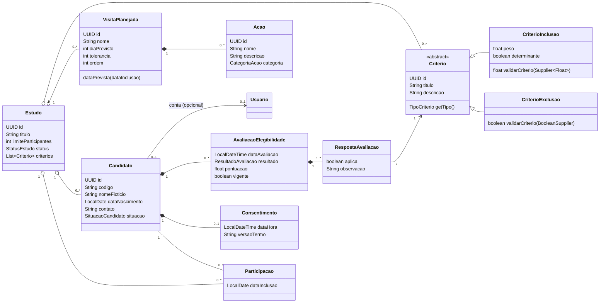
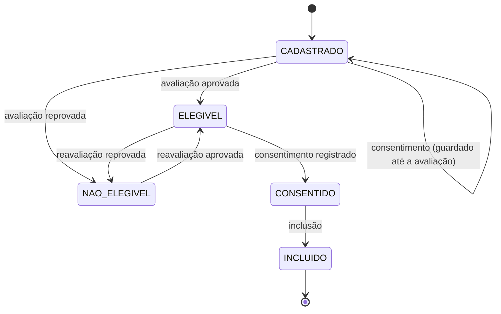

# Implementação do modelo de domínio de recrutamento (backend)

> Implementa o arquivo "coisas a afazer esw" (critérios, visitas planejadas, ações, candidato, avaliação de elegibilidade, consentimento e participação) no backend Spring Boot, com **Model** (entidades, enums, migration, repositórios), **Controller** (endpoints REST, DTOs, services) e testes. A **View** (telas React) não foi feita: ficou fora do escopo combinado.

## 1. Visão geral

## 2. O que foi criado

### 2.1 Model (`domain`)

| Classe | Tabela | Observações |
|---|---|---|
| `Criterio` (abstrata) | `criterios` | Herança de **tabela única**: a coluna `tipo` (`INCLUSAO`/`EXCLUSAO`) distingue as subclasses. Atributos: `id`, `estudo`, `titulo`, `descricao` |
| `CriterioInclusao` | `criterios` | `peso` (float) e `determinante` (boolean). `validarCriterio(validador)` devolve a nota de 0 até o peso; `classificar(nota)` diz se é não atendido, parcial ou atendido |
| `CriterioExclusao` | `criterios` | Sempre determinante (sem atributo para isso). `validarCriterio(validador)` devolve só `boolean` |
| `VisitaPlanejada` | `visitas_planejadas` | `diaPrevisto` (dia 0 = inclusão), `tolerancia`, `ordem`. Calcula `dataPrevista`, `inicioDaJanela`, `fimDaJanela` e `estaNaJanela` a partir da data de inclusão |
| `Acao` | `acoes` | `nome`, `descricao`, `categoria` (`CategoriaAcao`). Apagada junto com a visita |
| `Candidato` | `candidatos` | `estudo`, `codigo` (CAND-001...), `nomeFicticio`, `dataNascimento`, `contato` (opcional), `usuario` (opcional), `situacao` |
| `AvaliacaoElegibilidade` | `avaliacoes_elegibilidade` | A "folha da prova": data, avaliador, resultado, pontuação e `vigente` |
| `RespostaAvaliacao` | `respostas_avaliacao` | A "resposta" de cada questão: critério, `aplica`, `observacao` |
| `Consentimento` | `consentimentos` | Um por candidato: data e hora, responsável (usuário), versão do termo |
| `Participacao` | `participacoes` | Um por candidato: `dataInclusao` (o "dia 0"), estudo e quem incluiu |
| `Estudo` (alterado) | `estudos` | Ganhou `List<Criterio> criterios` (`ArrayList`), agora **como tabela** (`@OneToMany(mappedBy = "estudo")`); fora do JSON do estudo |

Enums novos: `CategoriaAcao` (`AVALIACAO_CLINICA`, `EXAME_LABORATORIAL`, `EXAME_IMAGEM`, `QUESTIONARIO`, `MEDICACAO`, `OUTROS`), `SituacaoCandidato`, `ResultadoAvaliacao` (`APROVADO`, `REPROVADO`), `TipoCriterio` e `NivelAtendimento`.

A regra de elegibilidade é uma **função pura** em `domain/regra/RegraElegibilidade` (sem banco nem Spring): recebe os critérios e, para cada um, se ele se aplica ao candidato, e devolve elegível ou não, a pontuação e os critérios que reprovaram.

### 2.2 Migration `V4__create_recruitment_tables.sql`

Cria as 8 tabelas com chaves estrangeiras, `UNIQUE` (código por estudo, nome + nascimento por estudo, dia previsto por estudo, um consentimento e uma participação por candidato) e `CHECK` (tipo e peso dos critérios, tolerância 0 a 30, dia ≥ 0, categoria, situação, resultado). Critérios e visitas somem junto com o estudo (`ON DELETE CASCADE`); candidatos, participações e respostas usam `RESTRICT`, e os services devolvem 409 em vez de 500 nesses casos.

### 2.3 Controller

| Recurso | Endpoint | Leitura | Escrita |
|---|---|---|---|
| Critérios (RF05) | `GET/POST /api/estudos/{id}/criterios`, `PUT/DELETE .../criterios/{criterioId}` | pesquisador, coordenador | pesquisador |
| Visitas (RF06) | `GET/POST /api/estudos/{id}/visitas`, `PUT/DELETE .../visitas/{visitaId}` | pesquisador, coordenador | pesquisador |
| Ações (RF06) | `POST /api/visitas/{id}/acoes`, `PUT/DELETE .../acoes/{acaoId}` | (vêm dentro da visita) | pesquisador |
| Candidatos (RF08) | `GET/POST /api/estudos/{id}/candidatos` (paginado, `?situacao=&pagina=&tamanho=`), `GET/PUT /api/candidatos/{id}` | pesquisador, coordenador | coordenador |
| Elegibilidade (RF09) | `GET/POST /api/candidatos/{id}/avaliacoes` | pesquisador, coordenador | coordenador |
| Consentimento (RF10) | `GET/POST /api/candidatos/{id}/consentimento` | pesquisador, coordenador | coordenador |
| Inclusão (RF11) | `GET/POST /api/estudos/{id}/participantes`, `GET .../participantes/vagas` | pesquisador, coordenador | coordenador |

O administrador não acessa nenhum deles (`403`). As expressões ficam em `security/Permissoes`. Todos aparecem no Swagger UI, agrupados por tag.

### 2.4 Services e DTOs

`CriterioService`, `VisitaService`, `CandidatoService`, `AvaliacaoService`, `ConsentimentoService` e `ParticipacaoService`, mais dois auxiliares: `EstudoAcesso` (busca o estudo e confere o estado exigido) e `UsuarioAutenticado` (resolve quem fez a requisição pelo `sub` do token). Os services devolvem DTOs (`*Response`), porque o mapeamento precisa acontecer dentro da transação.

## 3. Regras de negócio

| Regra | Onde | Resposta quando violada |
|---|---|---|
| Critérios e visitas só mudam com o estudo em **planejamento** | `CriterioService`, `VisitaService` | 409 `ESTUDO_FORA_DE_PLANEJAMENTO` |
| Candidato, avaliação, consentimento e inclusão só com o estudo em **recrutamento** | `EstudoAcesso` | 409 `ESTUDO_FORA_DE_RECRUTAMENTO` |
| Mesmo título de critério (ignorando maiúsculas) no mesmo tipo e estudo | `CriterioService` | 409 `CRITERIO_DUPLICADO` |
| Tipo de um critério não pode mudar | `CriterioService` | 400 |
| Critério já usado em avaliação não é excluído | `CriterioService` | 409 `CRITERIO_EM_USO` |
| Dois dias previstos iguais no estudo | `VisitaService` | 409 `VISITA_DIA_DUPLICADO` |
| `ordem` da visita = posição pelo dia previsto (recalculada a cada mudança) | `VisitaService` | — |
| Código `CAND-001`, `CAND-002`... único no estudo, gerado com o estudo bloqueado (sem repetir em cadastros simultâneos) | `CandidatoService` | — |
| Mesmo nome fictício (ignorando maiúsculas) e data de nascimento no estudo | `CandidatoService` | 409 `CANDIDATO_DUPLICADO` |
| Data de nascimento no passado | DTO | 400 |
| Edição do candidato só até a inclusão | `CandidatoService` | 409 `CANDIDATO_JA_INCLUIDO` |
| Avaliação responde exatamente a todos os critérios do estudo (sem faltar, repetir ou sobrar) | `AvaliacaoService` | 400 |
| Elegível = todos os critérios de inclusão **determinantes** atendidos e nenhum de exclusão satisfeito | `RegraElegibilidade` | — |
| Nova avaliação vira a vigente; as anteriores ficam no histórico | `AvaliacaoService` | — |
| Um consentimento por candidato; data/hora não pode ser futura; versão padrão `TCLE-SIMULADO v1` (configurável em `app.consentimento.versao-termo`) | `ConsentimentoService` | 409 `CONSENTIMENTO_DUPLICADO` / 400 |
| Inclusão exige, nesta ordem: estudo em recrutamento, candidato do estudo e ainda não incluído, avaliação vigente aprovada, consentimento e vaga | `ParticipacaoService` | 409 `CANDIDATO_JA_INCLUIDO`, `CANDIDATO_NAO_ELEGIVEL`, `CONSENTIMENTO_AUSENTE`, `VAGAS_ESGOTADAS` (candidato de outro estudo: 404) |
| Inclusões simultâneas nunca passam do limite: o estudo é carregado com bloqueio de escrita (`PESSIMISTIC_WRITE`) dentro da transação | `ParticipacaoService` | — |
| Estudo com candidatos não é excluído | `EstudoService` | 409 `ESTUDO_COM_CANDIDATOS` |

Erros de regra (409) vêm como `{"erro": "mensagem", "codigo": "CODIGO_DA_REGRA"}`, para a tela traduzir o código em uma mensagem clara.

### Situação do candidato

A avaliação aprovada de quem **já tem** consentimento leva direto a `CONSENTIDO`. A inclusão não depende só da situação: confere a avaliação vigente e o consentimento nos dados.

## 4. Decisões e diferenças em relação ao arquivo de origem

Estas são as escolhas que o arquivo deixava em aberto ou contradizia o plano da Sprint 2. **Vale a equipe confirmar.**

| # | Ponto | O que foi feito | Por quê |
|---|---|---|---|
| 1 | `validarCriterio(Consumer<>)` | Usei `Supplier<Float>` (inclusão) e `BooleanSupplier` (exclusão) | Um `Consumer` não devolve valor, e o método precisa devolver `float`/`boolean` |
| 2 | Uma ficha de avaliação por candidato ("composição") | Várias avaliações por candidato, só uma vigente | O critério de aceite do RF09 pede que reavaliações preservem o histórico |
| 3 | Todos os critérios de inclusão devem se aplicar (plano, regra 4) × critérios não determinantes (arquivo) | Só os **determinantes** reprovam; os demais somam pontos. O padrão ao criar é `determinante = true` | Com o padrão, o comportamento coincide com a regra do plano |
| 4 | Fluxo "avaliação, depois consentimento" (arquivo) × consentimento independente (plano, regra 5) | O consentimento pode vir antes ou depois; a inclusão exige os dois | Dá flexibilidade e atende às duas leituras |
| 5 | Código do candidato `PAC-001` (exemplo do arquivo) × `CAND-001` (plano) | `CAND-001` | É o que o plano e os testes E2E (T66) esperam. Está em uma linha só em `CandidatoService.criar` |
| 6 | Campos que o arquivo não detalha | `ordem` da visita é derivada do dia previsto; `peso` do critério de inclusão tem padrão 1; a tolerância vai de 0 a 30 dias | Seguem o plano da Sprint 2 (RF05 e RF06) |
| 7 | Situação `EM_AVALIACAO` | Existe no enum, mas a API avalia todos os critérios de uma vez e não a usa | Estava na lista do arquivo; fica reservada para uma avaliação em etapas |
| 8 | Erros de regra | 409 com `codigo`; validação continua 400 | Premissa 9 do plano da Sprint 2 |
| 9 | Transição de estado do estudo (RF07) | **Não implementada** | Não estava no arquivo. Hoje o estado muda pelo `PUT /api/estudos/{id}`, que permite qualquer valor; a máquina de estados (T41/T42) é uma task à parte |

## 5. Testes

| Suíte | Cobre |
|---|---|
| `DominioRecrutamentoTest` (10, unitários) | `validarCriterio` de inclusão (0, parcial, peso, limites) e de exclusão; `classificar`; a regra de elegibilidade (elegível, determinante reprova, não determinante só pontua, exclusão reprova, várias falhas, sem critérios); datas e janela da visita |
| `RecrutamentoIntegrationTest` (11, tokens reais) | Critérios e visitas (validações, duplicidade, ordem, cascata, somente leitura fora de planejamento); fluxo completo (cadastro, duplicidade, avaliação incompleta e reprovada, reavaliação com histórico, consentimento, inclusão, vagas); consentimento antes da avaliação; vagas esgotadas; estudo fora de recrutamento e candidato de outro estudo; paginação e filtro; exclusão de estudo e de critério em uso; permissões por perfil |

Total do backend: **91 testes, 0 falhas, 93% de cobertura de linhas**. O `ddl-auto=validate` do Hibernate confere as entidades novas contra a `V4`.

**Atualização (Release 1):** o teste de concorrência com várias threads foi feito na T62 (`ParticipacaoConcorrenciaTest`): com 6 inclusões simultâneas para 1 vaga, exatamente 1 é aceita, e sem o bloqueio `PESSIMISTIC_WRITE` o teste falha.

## 6. O que ficou de fora

> **Atualização (Release 1):** a lista abaixo descreve o estado da implementação do modelo de domínio. Depois dela, as telas, a máquina de estados, o contrato OpenAPI e o teste de concorrência foram entregues (T37, T39 a T43, T46, T49, T52, T55, T58, T61 e T62); só o cálculo da agenda real do participante continua fora da Release 1. Cada item abaixo traz o desfecho.

- **View (telas React):** nenhuma tela nova nesta entrega. *Desfecho:* as abas Critérios, Visitas, Candidatos e Participantes e a ficha do candidato (avaliação, consentimento e inclusão) foram implementadas nas tasks T39, T46, T49, T52, T55, T58 e T61.
- **Máquina de estados do estudo e histórico de transições** (T41/T42, tabela `study_status_history`). *Desfecho:* implementada (`MaquinaEstadosEstudo`, `POST /api/estudos/{id}/transicoes` e histórico em `GET .../historico-status`).
- **Cálculo da agenda real do participante** a partir da `dataInclusao`: os métodos de `VisitaPlanejada` existem e estão testados, mas ainda não há endpoint que gere a agenda (previsto para o aplicativo mobile).
- **Contrato OpenAPI em YAML** (T37): o Swagger é gerado pelas anotações, e os caminhos usam português (`/api/estudos/.../criterios`) em vez de `/studies/.../criteria` do plano. *Desfecho:* o contrato é `docs/api/openapi-sprint2.yaml`, comparado com a API pelo `ContratoOpenApiTest`.
- **Teste de concorrência** (seção 5). *Desfecho:* implementado na T62.
