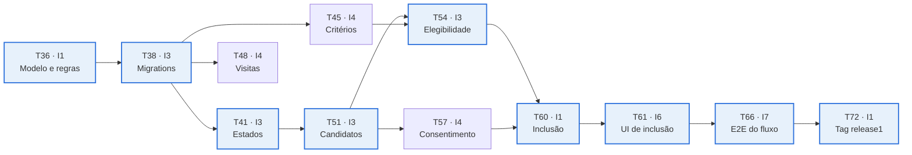

# Planejamento da Sprint 2 — ClinicalStudyPB

27/10/2026 · Carlos André

## Visão geral e meta da Sprint

A Sprint 2 (27/10 a 09/11/2026) fecha a Release 1: ao final, o pesquisador define critérios, visitas e estados de um estudo, e o coordenador cadastra candidatos, avalia elegibilidade, registra consentimento e inclui participantes, tudo na aplicação web (RF05 a RF11).

| Item | Definição |
| --- | --- |
| Meta da Sprint | Aplicação web funcional com o fluxo completo de recrutamento: do estudo em planejamento ao participante incluído, respeitando estados, elegibilidade, consentimento e limite de vagas |
| Requisitos | RF05, RF06 e RF07 (Módulo B); RF08, RF09, RF10 e RF11 (Módulo C); todos na interface Web |
| Também previsto na especificação | Integração das telas web com o backend; testes e correção de defeitos; RF01 a RF04 da Sprint 1 continuam funcionando |
| Entrega | Release 1 em 09/11/2026: tag release1, GitHub Release, releases/release1/README.md e apresentação do sistema em funcionamento |
| Equipe e método | 7 integrantes (I1 a I7, como na Sprint 1), Scrum, Azure Boards, GitHub, Stack A (Spring Boot, React + TypeScript, React Native + Expo, PostgreSQL) |
| Fora do escopo | Aplicativo mobile (login e telas do participante ficam para a Sprint 3) e RF12 em diante |

Premissa: os PBIs 01 a 08 da Sprint 1 estão integrados na branch principal. O que tiver ficado pendente entra como carry-over e consome a margem de capacidade (seção de capacidade, mais abaixo).

## Premissas e regras de negócio a validar no Planning

As tasks abaixo assumem as nove regras a seguir; o PO (I2) deve confirmá-las ou corrigi-las hoje, porque elas mudam o backend, as telas e os testes.

| # | Regra proposta | Tasks afetadas |
| --- | --- | --- |
| 1 | Critérios e visitas só podem ser alterados com o estudo em planejamento; depois ficam somente leitura | T45, T46, T48, T49 |
| 2 | Os estados só avançam, um de cada vez (planejamento, recrutamento, execução, encerrado). Para sair de planejamento são necessários ao menos um critério de inclusão e uma visita prevista. Só o pesquisador avança, e cada mudança registra usuário e data | T41, T42, T43 |
| 3 | Candidatos só são cadastrados com o estudo em recrutamento. O código é gerado pelo sistema, os dados são fictícios e o mesmo nome com a mesma data de nascimento não repete no estudo | T51, T52 |
| 4 | A avaliação precisa responder a todos os critérios do estudo. O candidato é elegível quando todos os critérios de inclusão se aplicam a ele e nenhum de exclusão se aplica. Uma nova avaliação passa a valer e a anterior fica no histórico | T54, T55 |
| 5 | O consentimento simulado é registrado independente da avaliação de elegibilidade (na prática o consentimento vem antes da triagem), com data, responsável e versão do termo. A inclusão exige os dois | T57, T58, T60 |
| 6 | A inclusão só ocorre com o estudo em recrutamento, candidato elegível, consentimento registrado e vaga disponível (incluídos menores que o limite). A checagem é feita em transação com bloqueio, para que inclusões simultâneas nunca passem do limite | T60, T61, T62 |
| 7 | Permissões: o pesquisador escreve RF05 a RF07 e lê os candidatos; o coordenador escreve RF08 a RF11 e lê estudo, critérios e visitas; o administrador não acessa recrutamento (conforme o diagrama de perfis da especificação). A regra vale no backend e na interface | T41, T45, T48, T51, T54, T57, T60 |
| 8 | O candidato terá um campo opcional para o usuário participante. A criação da conta do participante fica para a Sprint 3, junto do login mobile (RF17) | T36, T38, T51 |
| 9 | Erros seguem um formato único: 400 para validação de campos, 403 para perfil sem permissão, 404 para recurso inexistente e 409 para regra de negócio violada, sempre com um código da regra | T37 e todas as de backend |

## Product Backlog Items da Sprint

São 10 PBIs, 37 tasks e 143 horas. O RF06 (PBI-12) é o único de prioridade média, porque não bloqueia a cadeia de inclusão e é o primeiro item a renegociar se a capacidade real for menor.

| PBI | Entrega esperada | Requisitos | Prioridade | Horas | Tasks | Depende dos PBIs |
| --- | --- | --- | --- | --- | --- | --- |
| PBI-09 | Base técnica e contrato da API | Preparação | Alta | 18h | T36 a T40 | Sprint 1 |
| PBI-10 | Estados do estudo | RF07 | Alta | 15h | T41 a T44 | PBI-09 |
| PBI-11 | Critérios de inclusão e exclusão | RF05 | Alta | 11h | T45 a T47 | PBI-09 |
| PBI-12 | Visitas previstas e atividades | RF06 | Média | 13h | T48 a T50 | PBI-09 |
| PBI-13 | Cadastro de candidatos | RF08 | Alta | 13h | T51 a T53 | PBI-09, PBI-10 |
| PBI-14 | Avaliação de elegibilidade | RF09 | Alta | 15h | T54 a T56 | PBI-11, PBI-13 |
| PBI-15 | Consentimento simulado | RF10 | Alta | 8h | T57 a T59 | PBI-13 |
| PBI-16 | Inclusão de participantes | RF11 | Alta | 16h | T60 a T62 | PBI-10, PBI-14, PBI-15 |
| PBI-17 | Qualidade, integração e dados de demonstração | Integração e testes | Alta | 22h | T63 a T68 | PBI-11 a PBI-16 |
| PBI-18 | Documentação e entrega da Release 1 | Release 1 | Alta | 12h | T69 a T72 | Todos |
| **Total** |  |  |  | **143h** | **37 tasks** |  |

## Tasks detalhadas

Cada PBI traz uma tabela de controle (responsável, horas, prazo e dependências) e, abaixo dela, a descrição de cada task em passos. Prazos são o fim do dia indicado; "depende de" significa que a task só pode ser concluída depois das listadas, embora o início possa ser antecipado com mocks, como descrito em cada uma.

### PBI-09 · Base técnica e contrato da API (Alta · 18h)

Critério de aceite: modelo de domínio e regras aprovados, contrato OpenAPI publicado, novas tabelas migradas, página de detalhe do estudo com abas e web preparada para trabalhar sobre mocks.

| Task | Resp. | Horas | Prazo | Depende de |
| --- | --- | --- | --- | --- |
| T36 · Modelo de domínio e regras de negócio | I1 | 4h | Qua 28/10 | Sprint 1 integrada e premissas validadas |
| T37 · Contrato OpenAPI dos endpoints da Sprint | I1 | 3h | Qui 29/10 | T36 |
| T38 · Migrations Flyway e entidades JPA | I3 | 5h | Qui 29/10 | T36 |
| T39 · Página de detalhe do estudo com abas | I6 | 3h | Qui 29/10 | Sprint 1 (listagem de estudos, T29) |
| T40 · Tipos TypeScript e mocks a partir do contrato | I5 | 3h | Sex 30/10 | T37 |

**T36 · Modelo de domínio e regras de negócio.** Primeiro, releia as entidades de usuário e de estudo da Sprint 1 e liste as novas: Criterion (estudo, tipo inclusão ou exclusão, descrição, ordem), PlannedVisit (estudo, nome, dia previsto contado a partir da inclusão, janela de tolerância em dias, ordem) com Activity (nome, descrição, categoria), Candidate (estudo, código gerado, nome fictício, data de nascimento, contato opcional, usuário participante opcional, situação), EligibilityEvaluation com EligibilityAnswer (critério, se a condição se aplica ao candidato, observação), Consent (candidato, data e hora, responsável, versão do termo) e Participation (candidato, estudo, data de inclusão). Em seguida, desenhe o diagrama de classes em Mermaid em docs/diagramas/dominio.md e escreva a matriz de transição de estados e a lista de pré-condições da inclusão, a partir das premissas. Por fim, apresente o resultado na daily de quarta e registre as respostas do PO. Pronto quando diagrama e regras forem aprovados em Pull Request por I3 ou I4.

**T37 · Contrato OpenAPI dos endpoints da Sprint.** Escreva o contrato antes do código, para que web e backend andem em paralelo. Primeiro liste os endpoints: transição de estado do estudo; critérios, visitas e atividades de um estudo; candidatos de um estudo; avaliações e consentimento de um candidato; inclusão e listagem de participantes, com o resumo de vagas. Depois descreva tudo em docs/api/openapi-sprint2.yaml, com os DTOs de entrada e saída, exemplos de dados fictícios e o formato único de erro (status, código da regra, mensagem e lista de erros por campo), usando 400, 403, 404 e 409 como nas premissas. Por fim, avise o time: durante a Sprint, qualquer divergência é corrigida no YAML no mesmo Pull Request do código. Pronto quando I5 consegue gerar os tipos TypeScript a partir do arquivo.

**T38 · Migrations Flyway e entidades JPA.** Primeiro, crie as migrations seguintes às da Sprint 1 para as tabelas criterion, planned\_visit, visit\_activity, candidate, eligibility\_evaluation, eligibility\_answer, consent, participation e study\_status\_history, com chaves estrangeiras, UNIQUE de (estudo, nome, data de nascimento) em candidate, UNIQUE de candidato em participation e CHECK para tipos e situações. Confirme que a tabela de estudos tem a coluna de estado com os quatro valores e padrão planejamento, criando-a se faltar. Depois escreva as entidades JPA e os repositórios Spring Data, só com o necessário para as próximas tasks. Por fim, suba o backend em um banco vazio e em um banco já populado pela Sprint 1 para provar que a migração é segura. Pronto quando o Flyway aplica tudo e o Hibernate valida o esquema sem erro.

**T39 · Página de detalhe do estudo com abas.** Primeiro crie a rota protegida /studies/:studyId e carregue o estudo com o cliente Axios. Em seguida monte o cabeçalho, com título, estado atual e botão de voltar, e as abas Resumo, Critérios, Visitas, Candidatos e Participantes como rotas aninhadas do React Router, cada uma com conteúdo provisório. Depois mostre ou oculte as abas conforme o perfil (o pesquisador vê Critérios e Visitas; o coordenador vê Candidatos e Participantes) e ligue a listagem de estudos da Sprint 1 a essa página. Por fim, escreva testes de componente com Vitest e Testing Library para o título, as abas por perfil e o erro de estudo inexistente. As telas das demais tasks se encaixam nessas abas.

**T40 · Tipos TypeScript e mocks a partir do contrato.** Primeiro gere os tipos a partir do YAML com openapi-typescript e deixe o comando em um script npm. Depois configure o Mock Service Worker com respostas fictícias para cada endpoint do contrato, ativado por uma variável de ambiente, de modo que cada tela possa ser feita antes do backend correspondente. Em seguida crie os módulos de API tipados (estudos, critérios, visitas, candidatos, avaliações, consentimento, participantes) e uma função que converte o formato de erro padrão em mensagens por campo para os formulários. Pronto quando uma tela de teste lista dados vindos do mock sem alteração de código.

### PBI-10 · RF07 Estados do estudo (Alta · 15h)

Critério de aceite: o pesquisador avança o estudo de planejamento até encerrado, sem pular nem voltar; as regras impedem avanços inválidos e cada mudança fica registrada.

| Task | Resp. | Horas | Prazo | Depende de |
| --- | --- | --- | --- | --- |
| T41 · Máquina de estados do estudo (domínio) | I3 | 5h | Sex 30/10 | T36, T38 |
| T42 · Endpoint de transição de estado | I4 | 3h | Ter 03/11 | T37, T41 |
| T43 · Tela de estado e transições | I6 | 4h | Qua 04/11 | T39, T40, T42 |
| T44 · Testes do RF07 | I2 | 3h | Qua 04/11 | T41, T42 |

**T41 · Máquina de estados do estudo (domínio).** Primeiro crie o enum de estado (planejamento, recrutamento, execução, encerrado) e uma classe de domínio com o mapa de transições permitidas, em que cada estado só vai para o seguinte. Depois acrescente as pré-condições da saída de planejamento, ao menos um critério de inclusão e ao menos uma visita prevista, consultadas pelos repositórios criados em T38. Em seguida lance exceções de regra de negócio com códigos próprios (transição inválida, sem critérios, sem visitas), que o tratador global converte em 409. Por fim, grave cada mudança em study\_status\_history com estado anterior, novo estado, usuário e data. Mantenha a classe sem dependência de Spring Web, para testá-la isoladamente. Pronto quando as quatro regras funcionam em teste rápido, sem subir o servidor.

**T42 · Endpoint de transição de estado.** Primeiro crie POST /studies/{id}/transitions, que recebe o estado de destino e chama a classe de T41. Depois restrinja o acesso ao perfil pesquisador, com a autorização por perfil da Sprint 1, e trate 403, 404 e 409 no formato padrão do contrato. Por fim, anote o endpoint para o Swagger UI e confira que ele coincide com o YAML de T37. A resposta devolve o estudo atualizado, já com o novo estado.

**T43 · Tela de estado e transições.** Primeiro construa, com dados do mock, o indicador dos quatro estados no cabeçalho do estudo, destacando o atual. Depois acrescente o botão que avança para o próximo estado, visível só ao pesquisador e só quando existe próximo estado, com um diálogo de confirmação avisando que não é possível voltar. Em seguida trate o erro 409 mostrando a mensagem da regra (por exemplo, a falta de um critério de inclusão) em um alerta no topo da página. Por fim, conecte à API real quando T42 estiver integrada e escreva testes de componente: botão oculto para o coordenador, confirmação e erro de regra.

**T44 · Testes do RF07.** Primeiro escreva testes unitários parametrizados com JUnit e Mockito que percorram as 16 combinações de origem e destino (só 3 são válidas), as duas pré-condições e a gravação do histórico; o esqueleto pode ser montado na sexta, assim que T41 entrar na main. Depois escreva testes de integração com MockMvc sobre PostgreSQL para o endpoint: 200 no caminho feliz, 401 sem login, 403 para coordenador e participante, 404 e um 409 para cada regra. Por fim, registre o resultado e a cobertura da classe de domínio para o relatório da Sprint. Quem testa não é quem implementou: I2 revisa a lógica de I3 e o endpoint de I4.

### PBI-11 · RF05 Critérios de inclusão e exclusão (Alta · 11h)

Critério de aceite: o pesquisador define, edita e remove critérios de inclusão e exclusão enquanto o estudo está em planejamento; depois disso os critérios ficam somente leitura.

| Task | Resp. | Horas | Prazo | Depende de |
| --- | --- | --- | --- | --- |
| T45 · Backend de critérios | I4 | 4h | Sex 30/10 | T37, T38 |
| T46 · Tela de critérios | I6 | 4h | Ter 03/11 | T39, T40, T45 |
| T47 · Testes do RF05 | I7 | 3h | Qua 04/11 | T45, T46 |

**T45 · Backend de critérios.** Primeiro crie o serviço de critérios, com cadastro, edição, remoção e listagem por estudo, separando inclusão e exclusão. Depois implemente as validações: tipo obrigatório, descrição de 5 a 500 caracteres e bloqueio de descrição repetida (ignorando maiúsculas) dentro do mesmo tipo e estudo. Em seguida aplique a regra de estado: só é possível alterar com o estudo em planejamento, caso contrário 409 com código próprio. Por fim, exponha os endpoints em /studies/{id}/criteria, com escrita para o pesquisador e leitura para pesquisador e coordenador, documentados no Swagger conforme o YAML. Pronto quando um critério criado por API aparece na listagem e é recusado depois de o estudo sair de planejamento.

**T46 · Tela de critérios.** Primeiro monte, sobre o mock, a aba Critérios com duas listas, Inclusão e Exclusão, e um formulário para adicionar com tipo e descrição. Depois acrescente edição e remoção com confirmação e as mesmas validações do backend, mostrando erros por campo. Em seguida coloque a aba em modo somente leitura, com um aviso explicativo, quando o estudo não está em planejamento ou o usuário é coordenador, e exiba "adicione ao menos um critério de inclusão para avançar" quando a lista estiver vazia. Por fim, conecte à API real depois de T45 e escreva testes de componente da validação e do modo somente leitura.

**T47 · Testes do RF05.** Primeiro escreva testes unitários do serviço para descrição curta, longa e repetida, tipo ausente e estudo fora de planejamento. Depois escreva testes de integração dos endpoints: 201 ao criar, 400 com erros por campo, 403 por perfil, 404 e 409. Por fim, revise os testes de componente de T46 e complete as lacunas, como a lista vazia e o erro vindo do servidor. I7 não implementou nenhuma parte do RF05, o que garante um olhar independente.

### PBI-12 · RF06 Visitas previstas e atividades (Média · 13h)

Critério de aceite: o pesquisador define visitas com dia previsto e atividades enquanto o estudo está em planejamento, e o sistema devolve as visitas ordenadas.

| Task | Resp. | Horas | Prazo | Depende de |
| --- | --- | --- | --- | --- |
| T48 · Backend de visitas previstas e atividades | I4 | 5h | Ter 03/11 | T37, T38 |
| T49 · Tela de visitas e atividades | I5 | 5h | Qua 04/11 | T39, T40, T48 |
| T50 · Testes do RF06 | I7 | 3h | Qui 05/11 | T48, T49 |

**T48 · Backend de visitas previstas e atividades.** Primeiro implemente a visita prevista com nome obrigatório de até 100 caracteres, dia previsto (inteiro maior ou igual a zero, contado a partir da inclusão, sendo 0 a visita inicial), janela de tolerância de 0 a 30 dias e ordem derivada do dia. Depois implemente as atividades de cada visita, com nome, descrição e categoria (avaliação, exame, questionário ou outra); a categoria avaliação será a base dos resultados fictícios do RF14 na Sprint 3. Em seguida aplique as regras: dois dias previstos iguais no mesmo estudo são recusados, remover uma visita apaga suas atividades e toda alteração exige estudo em planejamento (409 caso contrário). Por fim, exponha /studies/{id}/visits e /visits/{id}/activities, devolvendo as visitas já ordenadas com suas atividades. A task começa na sexta, logo após T45, e fecha na terça.

**T49 · Tela de visitas e atividades.** Primeiro monte, sobre o mock, a lista de visitas ordenada pelo dia previsto, cada uma como cartão expansível com suas atividades. Depois crie os formulários de visita (nome, dia previsto, janela) e de atividade (nome, descrição, categoria em lista de seleção), com validação e erros do servidor por campo. Em seguida deixe tudo somente leitura fora do estado de planejamento e para o coordenador. Por fim, conecte à API real depois de T48 e escreva testes de componente dos formulários e do modo somente leitura.

**T50 · Testes do RF06.** Primeiro escreva testes unitários para dia repetido, dia negativo, janela fora do intervalo, remoção em cascata e estado bloqueado. Depois teste os endpoints de visitas e atividades (201, 400, 403, 404, 409) e a ordenação da resposta. Por fim, revise os testes de componente de T49. Pronto quando uma visita com atividades é criada, consultada e removida em um teste de integração da API.

### PBI-13 · RF08 Cadastro de candidatos (Alta · 13h)

Critério de aceite: o coordenador cadastra, lista e edita candidatos de um estudo em recrutamento, com dados fictícios e sem duplicidade.

| Task | Resp. | Horas | Prazo | Depende de |
| --- | --- | --- | --- | --- |
| T51 · Backend de candidatos | I3 | 5h | Ter 03/11 | T38, T41 |
| T52 · Tela de candidatos e ficha do candidato | I5 | 5h | Qua 04/11 | T39, T40, T51 |
| T53 · Testes do RF08 | I4 | 3h | Qui 05/11 | T51 |

**T51 · Backend de candidatos.** Primeiro crie o cadastro de candidato com nome fictício, data de nascimento no passado, contato opcional e um código gerado pelo sistema (CAND-001, CAND-002 e assim por diante), único dentro do estudo; nenhum dado real ou documento pessoal é armazenado. Depois aplique as regras: só é possível cadastrar com o estudo em recrutamento (409 com código próprio), candidato com mesmo nome e data de nascimento no estudo é recusado como duplicado, a situação inicial é cadastrado e a edição é permitida até a inclusão. Em seguida implemente a listagem paginada com filtro por situação e o detalhe do candidato, que já devolve um resumo da última avaliação e do consentimento para as telas das próximas tasks. Por fim, restrinja a escrita ao coordenador e a leitura a coordenador e pesquisador. Pronto quando o fluxo cadastrar, listar, filtrar e editar funciona por Swagger UI.

**T52 · Tela de candidatos e ficha do candidato.** Primeiro monte a aba Candidatos, sobre o mock, com lista paginada, filtro por situação e colunas de elegibilidade e consentimento. Depois crie o formulário de cadastro (nome fictício, data de nascimento, contato), com validação, erro de duplicidade vindo do servidor e botão desabilitado, com explicação, quando o estudo não está em recrutamento. Em seguida crie a ficha do candidato, a página que recebe as seções de avaliação (T55), consentimento (T58) e inclusão (T61) como espaços reservados, para que cada colega encaixe a sua parte sem conflito de arquivos. Por fim, conecte à API real depois de T51 e escreva os testes de componente do formulário e da listagem. A ficha é a peça de que três outras tasks dependem, então ela deve ser integrada na main logo que o esqueleto estiver pronto.

**T53 · Testes do RF08.** Primeiro escreva testes unitários do serviço: duplicidade, data futura, estudo fora de recrutamento e edição após a inclusão. Depois teste os endpoints: 201, 400, 403 (pesquisador e participante não escrevem), 404, 409, paginação e filtro. Por fim, confira a geração do código sequencial em cadastros seguidos no mesmo estudo e em estudos diferentes.

### PBI-14 · RF09 Avaliação de elegibilidade (Alta · 15h)

Critério de aceite: o coordenador registra a avaliação de cada critério do estudo e o sistema calcula a elegibilidade; reavaliações preservam o histórico.

| Task | Resp. | Horas | Prazo | Depende de |
| --- | --- | --- | --- | --- |
| T54 · Backend de elegibilidade | I3 | 6h | Qua 04/11 | T45, T51 |
| T55 · Tela de avaliação de elegibilidade | I7 | 6h | Qui 05/11 | T52, T54 |
| T56 · Testes do RF09 | I2 | 3h | Qui 05/11 | T54 |

**T54 · Backend de elegibilidade.** Primeiro escreva a regra como uma função pura de domínio: ela recebe os critérios do estudo e as respostas (cada uma diz se a condição do critério se aplica ao candidato) e devolve elegível apenas quando todos os critérios de inclusão se aplicam e nenhum de exclusão se aplica, junto com a lista dos critérios que causaram a inelegibilidade. Essa função não depende de nenhuma outra task, então I3 pode escrevê-la e testá-la a partir do fim de semana, antes de T51. Depois crie o serviço, que exige respostas para todos os critérios do estudo, sem faltar nem sobrar (400 caso contrário), grava a avaliação com avaliador, data e resultado, marca a anterior como substituída e atualiza a situação do candidato para elegível ou não elegível. Em seguida bloqueie a avaliação se o estudo não está em recrutamento ou se o candidato já foi incluído (409). Por fim, exponha POST e GET em /candidates/{id}/evaluations, com o histórico, restritos ao coordenador.

**T55 · Tela de avaliação de elegibilidade.** Primeiro monte, na ficha do candidato, o formulário com os critérios do estudo em dois grupos; cada critério tem a resposta "se aplica" ou "não se aplica" e um campo de observação, e o texto deixa claro que nos critérios de exclusão "se aplica" reprova o candidato. Comece sobre o mock na sexta, quando T40 estiver pronta. Depois mantenha o botão Salvar desabilitado até todos os critérios serem respondidos. Em seguida exiba o resultado calculado pelo backend, com destaque e com os critérios que levaram à inelegibilidade, e uma lista com o histórico de avaliações. Por fim, trate os erros 400 e 409 e escreva testes de componente do formulário completo, do botão desabilitado e da exibição do resultado.

**T56 · Testes do RF09.** Primeiro escreva a matriz de testes unitários da regra pura: tudo de inclusão aplicado e nenhuma exclusão (elegível); uma inclusão não aplicada; uma exclusão aplicada; várias falhas ao mesmo tempo; estudo sem critérios de exclusão; resposta faltando; resposta de critério de outro estudo. Depois teste o serviço: a reavaliação preserva o histórico, e candidato incluído ou estudo fora de recrutamento resultam em 409. Por fim, teste os endpoints (201, 400, 403, 404, 409).

### PBI-15 · RF10 Consentimento simulado (Alta · 8h)

Critério de aceite: o coordenador registra o consentimento simulado de um candidato e fica um comprovante com data, responsável e versão do termo.

| Task | Resp. | Horas | Prazo | Depende de |
| --- | --- | --- | --- | --- |
| T57 · Backend de consentimento | I4 | 3h | Qua 04/11 | T51 |
| T58 · Tela de consentimento | I5 | 3h | Qui 05/11 | T52, T57 |
| T59 · Testes do RF10 | I7 | 2h | Sex 06/11 | T57, T58 |

**T57 · Backend de consentimento.** Primeiro crie o registro de consentimento com candidato, data e hora (que não pode ser futura), responsável e versão do termo simulado, um texto fixo e configurável como TCLE-SIMULADO v1. Depois aplique as regras: um consentimento por candidato (duplicado dá 409), estudo em recrutamento e candidato ainda não incluído. Em seguida exponha POST e GET em /candidates/{id}/consent, com escrita do coordenador, e inclua o resumo do consentimento no detalhe do candidato. A revogação fica fora desta Sprint; a retirada do participante é o RF16.

**T58 · Tela de consentimento.** Primeiro monte, na ficha do candidato, a seção Consentimento com o texto do termo simulado, rolável, e o aviso "consentimento simulado, dados fictícios". Depois acrescente a caixa de confirmação, a data e hora (padrão: agora) e o botão Registrar, que só habilita com a confirmação marcada. Em seguida, após registrar, mostre o comprovante (data, responsável, versão) e desabilite o formulário. Por fim, conecte à API real e escreva testes de componente da confirmação obrigatória e do comprovante.

**T59 · Testes do RF10.** Primeiro teste unitariamente data futura, duplicidade, estudo fora de recrutamento e candidato incluído. Depois teste os endpoints (201, 400, 403, 404, 409) e a presença do resumo no detalhe do candidato. Por fim, revise os testes de componente de T58.

### PBI-16 · RF11 Inclusão de participantes (Alta · 16h)

Critério de aceite: o coordenador inclui candidatos elegíveis e com consentimento; o sistema nunca ultrapassa o limite de vagas e cada bloqueio explica o motivo.

| Task | Resp. | Horas | Prazo | Depende de |
| --- | --- | --- | --- | --- |
| T60 · Backend de inclusão de participantes | I1 | 7h | Qui 05/11 | T41, T54, T57 |
| T61 · Tela de inclusão e lista de participantes | I6 | 5h | Sex 06/11 | T52, T60 |
| T62 · Testes do RF11 (limite de vagas e concorrência) | I2 | 4h | Sex 06/11 | T60 |

**T60 · Backend de inclusão de participantes.** Primeiro crie o serviço de inclusão em uma única transação. Nela, carregue o estudo com bloqueio de escrita, para que inclusões simultâneas sejam atendidas uma por vez, e verifique, nesta ordem: estudo em recrutamento, candidato pertencente ao estudo e ainda não incluído, última avaliação vigente elegível, consentimento registrado e número de participantes menor que o limite de vagas. Cada falha devolve 409 com um código distinto, para a tela explicar o motivo. Depois, se tudo passar, grave a participação com data e usuário e mude a situação do candidato para incluído. Em seguida exponha POST e GET em /studies/{id}/participants e um resumo de vagas (incluídos, limite, vagas restantes). Por fim, restrinja a escrita ao coordenador. Comece na sexta pelo esqueleto e pelas regras de domínio com repositórios simulados, e feche a integração real assim que T54 e T57 entrarem na main, na quarta. Pronto quando uma inclusão válida funciona e cada regra violada é recusada com o código certo.

**T61 · Tela de inclusão e lista de participantes.** Primeiro monte, na ficha do candidato, a seção Inclusão com as quatro pré-condições (estudo em recrutamento, candidato elegível, consentimento registrado, vaga disponível), cada uma marcada como atendida ou pendente a partir do detalhe do candidato e do resumo de vagas. Depois acrescente o botão Incluir no estudo, habilitado só quando todas estão atendidas, com confirmação. Em seguida construa a aba Participantes, com a lista de incluídos e o contador "X de N vagas" atualizado após cada inclusão. Por fim, traduza cada código de erro do backend (por exemplo, vagas esgotadas) em uma mensagem clara e escreva testes de componente da lista de pré-condições e dos erros. Comece sobre o mock na quarta e conecte à API real assim que T60 entrar na main.

**T62 · Testes do RF11 (limite de vagas e concorrência).** Primeiro escreva os testes unitários de cada pré-condição isolada e do limite exato (a última vaga é aceita, a seguinte é recusada). Depois escreva os testes de integração dos endpoints: 201, 400, 403, 404 e um 409 para cada regra, conferindo o código do erro. Em seguida escreva o teste de concorrência: com uma única vaga restante, dispare várias inclusões simultâneas (ExecutorService e CountDownLatch) e confirme que exatamente uma retorna 201, as demais retornam 409 e o total de participantes nunca passa do limite. Por fim, registre o resultado no relatório de testes.

### PBI-17 · Qualidade, integração e dados de demonstração (Alta · 22h)

Critério de aceite: sistema integrado sem mocks, com dados de demonstração, cobertura mínima de 80% verificada no CI, E2E do fluxo completo e defeitos críticos corrigidos.

| Task | Resp. | Horas | Prazo | Depende de |
| --- | --- | --- | --- | --- |
| T63 · Dados fictícios de demonstração | I4 | 3h | Qui 05/11 | T45, T48, T51, T57 |
| T64 · Cobertura mínima de 80% no CI (JaCoCo) | I1 | 4h | Sex 30/10 (relatório) e Qui 05/11 (bloqueio) | T38 |
| T65 · Infraestrutura de testes E2E (Playwright) | I7 | 3h | Sex 30/10 | Sprint 1 (login web, T21) |
| T66 · E2E do fluxo completo da Release 1 | I7 | 4h | Sex 06/11 | T61, T63, T65 |
| T67 · Integração e correções: planejamento do estudo | I6 | 4h | Qui 05/11 | T43, T46, T49 |
| T68 · Integração e correções: recrutamento | I5 | 4h | Sex 06/11 | T52, T55, T58, T61 |

**T63 · Dados fictícios de demonstração.** Primeiro crie um script SQL repetível do Flyway, ativado só no perfil demo, que não duplica dados se rodar duas vezes. Depois inclua um usuário de cada perfil, com senhas fictícias guardadas como hash, dois estudos (um em planejamento, com critérios e visitas, e outro em recrutamento) e cerca de seis candidatos em situações diferentes, deixando um estudo a uma vaga do limite para demonstrar o bloqueio. Por fim, documente os usuários e senhas fictícias no README, sem nenhuma credencial real.

**T64 · Cobertura mínima de 80% no CI (JaCoCo).** Primeiro adicione o JaCoCo ao build do backend e defina o que conta como código de negócio (pacotes de domínio e serviços), excluindo código gerado, configurações e DTOs, como pede a especificação. Depois publique o relatório como artefato do GitHub Actions e resuma a cobertura na execução do pipeline; até quinta ele apenas informa, sem bloquear. Em seguida, na quinta 05/11, ative a regra que falha o pipeline abaixo de 80% das linhas e corrija as lacunas junto com os autores dos testes. Por fim, guarde o relatório final para a seção de testes e cobertura do README.

**T65 · Infraestrutura de testes E2E (Playwright).** Primeiro instale o Playwright na aplicação web e configure navegador, URL base e repetição de testes instáveis. Depois crie uma rotina de login por API que guarda a sessão de cada perfil para reutilizar nos testes, e o objeto de página da tela de login. Em seguida escreva o primeiro teste E2E (login válido, login inválido e logout) e configure um job do GitHub Actions que sobe PostgreSQL, backend e web e roda os testes. Pronto quando o teste roda no CI com um comando documentado.

**T66 · E2E do fluxo completo da Release 1.** Primeiro escreva o cenário feliz: o pesquisador entra, cria um estudo, define um critério de inclusão, um de exclusão e uma visita e avança para recrutamento; o coordenador entra, cadastra um candidato, registra a avaliação e o consentimento e inclui, e o teste confere que o participante aparece na lista e que o contador de vagas aumentou. Depois escreva o cenário de erro: com o estudo de demonstração a uma vaga do limite, a segunda inclusão é bloqueada com a mensagem de vagas esgotadas. Em seguida inclua um teste de regressão mínimo de RF01 a RF04 (login, cadastro de usuário e de estudo) e rode tudo no CI. Como T61 fecha no mesmo dia, escreva o roteiro e os objetos de página na quarta e na quinta, sobre as telas já integradas, e na sexta conecte só o passo final de inclusão.

**T67 · Integração e correções: planejamento do estudo.** Primeiro suba o ambiente completo sem mocks, com Docker Compose, e percorra o fluxo de planejamento: criar estudo, definir critérios e visitas e avançar de estado, nos perfis de pesquisador e coordenador. Depois corrija os defeitos que aparecerem (CORS, campos diferentes do contrato, mensagens de erro, estados de carregamento e lista vazia, permissões visuais), registrando cada um como Bug no Azure Boards ligado à task de origem e corrigindo o YAML quando o contrato mudar. Por fim, confirme que RF01 a RF04 continuam funcionando.

**T68 · Integração e correções: recrutamento.** Primeiro faça o mesmo roteiro de T67 para o recrutamento, com os dados de demonstração: cadastrar candidato, avaliar, registrar consentimento e incluir, nos casos de sucesso e de erro (estudo fora de recrutamento, candidato duplicado, avaliação incompleta, vagas esgotadas). Depois confira paginação, mensagens por código de erro e rótulos de formulário, registre os defeitos como Bugs e corrija os da sua área. Por fim, passe pela checagem de regressão de login, usuários e estudos da Sprint 1.

### PBI-18 · Documentação e entrega da Release 1 (Alta · 12h)

Critério de aceite: README principal e README da release completos, diagramas renderizando no GitHub, tag release1, GitHub Release e apresentação ensaiada.

| Task | Resp. | Horas | Prazo | Depende de |
| --- | --- | --- | --- | --- |
| T69 · Diagramas: casos de uso, classes, sequência e arquitetura | I2 | 4h | Sex 06/11 | T36, T60 |
| T70 · README principal | I2 | 2h | Sex 06/11 | T64, T66, T69 |
| T71 · README da release e processo de desenvolvimento | I2 | 4h | Seg 09/11 (manhã) | T66, T70 |
| T72 · Tag release1, GitHub Release e apresentação | I1 | 2h | Seg 09/11 (antes da apresentação) | T66, T71 |

**T69 · Diagramas: casos de uso, classes, sequência e arquitetura.** Primeiro atualize o diagrama de classes de T36 com o que foi realmente implementado. Depois desenhe em Mermaid o diagrama de casos de uso (quatro perfis e os requisitos RF01 a RF11), duas sequências (avançar o estado do estudo e incluir participante, com as verificações e o bloqueio de vagas) e a arquitetura atualizada, mostrando web, mobile, backend e PostgreSQL. Por fim, abra a prévia no GitHub para confirmar que todos renderizam e salve em docs/diagramas. O rascunho de classes sai na quarta; a sequência de inclusão só depois de T60.

**T70 · README principal.** Primeiro monte o índice com as sete seções exigidas: apresentação e escopo com os sete integrantes; arquitetura com os diagramas; funcionalidades RF01 a RF11 com capturas de sucesso e de erro; stack com versões e pré-requisitos; instalação e execução com as credenciais fictícias de T63; testes e cobertura com o relatório do JaCoCo e dos testes E2E; documentação da API com o link do Swagger UI. Depois recolha, até sexta ao meio-dia, as capturas de tela que cada integrante fez das telas que implementou, pois a documentação é responsabilidade de todos. Por fim, valide as instruções seguindo-as em um clone limpo do repositório e inclua links para as três releases.

**T71 · README da release e processo de desenvolvimento.** Primeiro crie releases/release1/README.md com objetivo e sprints abrangidas, situação de cada requisito (concluído, parcial ou não implementado, com justificativa), funcionalidades com capturas, alterações de arquitetura e stack, resultados dos testes e da cobertura e problemas conhecidos. Depois escreva a seção Processo de desenvolvimento das Sprints 1 e 2: backlog e tarefas, papéis e contribuições dos sete integrantes, burndown do Azure DevOps com análise do planejado contra o realizado e a revisão, com impedimentos e ações de melhoria. O rascunho completo fica pronto na sexta; o burndown final da Sprint 2 e o resultado da retrospectiva entram na segunda de manhã.

**T72 · Tag release1, GitHub Release e apresentação.** Primeiro confirme que a branch principal está verde no CI e que o clone limpo executa conforme o README. Depois crie a tag release1 no commit entregue e a GitHub Release, com o resumo e o link para releases/release1/README.md. Em seguida ensaie a demonstração com o time, nesta ordem: o pesquisador define o estudo, o coordenador inclui um participante, uma tentativa é bloqueada por falta de vagas, e então o relatório de testes e cobertura e o Swagger UI. A avaliação usa a versão da tag, então nada é alterado depois dela.

## Dependências e caminho crítico

O caminho crítico leva do modelo de domínio à tag release1 em nove tasks; um dia de atraso em qualquer uma delas atrasa a entrega.

Legenda: os nós em azul formam o caminho crítico; os demais são tasks em paralelo.

- T37 (contrato) e T40 (mocks) liberam as telas web em paralelo.
- T41 também precede T60; T63 e T65 alimentam T66.
- T48 (visitas) fica fora da cadeia de inclusão: o RF06 é o primeiro a renegociar.

As setas indicam "depende de". As demais dependências estão nas tabelas de cada PBI. Como a cadeia T51, T54, T60 e T61 ocupa de terça a sexta, as partes independentes dessas tasks (a função pura de elegibilidade, o esqueleto de T60 e as telas sobre mocks) devem começar antes, como descrito em cada uma.

## Calendário de prazos por dia

Todas as 37 tasks têm dia de conclusão; a quinta 05/11 é o congelamento de funcionalidades (RF05 a RF11 na branch principal) e a sexta 06/11 às 18h é o congelamento de código, depois do qual só entram correções críticas. A segunda 02/11 é feriado (Finados) e os fins de semana não têm prazos: servem de reserva.

| Dia | Marco do dia | Tasks que devem estar concluídas |
| --- | --- | --- |
| Ter 27/10 | Sprint Planning; Sprint 2, PBIs e tasks cadastrados no Azure Boards | Nenhuma (o cadastro no Azure Boards é feito hoje) |
| Qua 28/10 | Domínio e regras de negócio fechados | T36 |
| Qui 29/10 | Base pronta: contrato da API, banco e página de detalhe do estudo | T37, T38, T39 |
| Sex 30/10 | Backend de estados e critérios; mocks da web; cobertura em modo relatório; E2E configurado | T40, T41, T45, T64 (relatório), T65 |
| Sáb 31/10 a Seg 02/11 | Sem prazos: fim de semana e feriado de Finados; adiantar telas sobre mocks e a função pura de elegibilidade | Nenhuma |
| Ter 03/11 | Endpoint de estado, visitas e candidatos no backend; tela de critérios | T42, T46, T48, T51 |
| Qua 04/11 | Elegibilidade e consentimento no backend; telas de estado, visitas e candidatos; ficha do candidato integrada; checkpoint do caminho crítico | T43, T44, T47, T49, T52, T54, T57 |
| Qui 05/11 | Congelamento de funcionalidades: RF05 a RF11 integrados na main; cobertura passa a bloquear o CI; dados de demonstração | T50, T53, T55, T56, T58, T60, T63, T64 (bloqueio), T67 |
| Sex 06/11 | Congelamento de código às 18h; tela de inclusão, testes de vagas, E2E, diagramas e README principal | T59, T61, T62, T66, T68, T69, T70 |
| Sáb 07 e Dom 08/11 | Sem prazos: reserva para defeitos críticos | Nenhuma |
| Seg 09/11 | Entrega da Release 1: README da release com burndown final, tag, GitHub Release, Sprint Review, Retrospectiva e apresentação | T71, T72 |

## Distribuição entre os integrantes e capacidade

Cada integrante recebe de 20 a 21 horas, dentro do limite hipotético de 24 horas por pessoa usado na Sprint 1. As atribuições são provisórias e devem ser trocadas pelos nomes depois do Planning; as áreas técnicas são formas de coordenação, e testes, documentação e revisão de código continuam compartilhados (nenhum integrante testa o que ele mesmo implementou).

| Integrante | Foco principal | Tasks | Horas |
| --- | --- | --- | --- |
| I1 | Scrum Master, arquitetura e DevOps | T36, T37, T60, T64, T72 | 20h |
| I2 | Product Owner, testes e documentação | T44, T56, T62, T69, T70, T71 | 20h |
| I3 | Backend: domínio, persistência e estudos | T38, T41, T51, T54 | 21h |
| I4 | Backend: usuários, segurança e autorização | T42, T45, T48, T53, T57, T63 | 21h |
| I5 | Frontend React: autenticação e integração | T40, T49, T52, T58, T68 | 20h |
| I6 | Frontend React: estudos e protótipos | T39, T43, T46, T61, T67 | 20h |
| I7 | Mobile, protótipos e testes | T47, T50, T55, T59, T65, T66 | 21h |
| **Total** |  | 37 tasks | **143h** |

| Indicador | Hipótese para discussão |
| --- | --- |
| Disponibilidade por integrante | 12 horas por semana |
| Capacidade em duas semanas | 7 × 12h × 2 = 168 horas |
| Horas planejadas nas tasks | 143 horas |
| Margem de capacidade | 25 horas (cerca de 15%) |

Pontos de atenção: I3 e I1 concentram o caminho crítico, e I3 tem T51 e T54 em dois dias seguidos. A margem de 25 horas precisa absorver o carry-over da Sprint 1, as cerimônias e os defeitos encontrados na integração. O aplicativo mobile não tem tasks nesta Sprint; I7 atua em testes e na tela de elegibilidade e deve ler o contrato de autenticação para antecipar o login mobile da Sprint 3. I2 concentra as horas na segunda semana e, na primeira, atua como PO (validar premissas, refinar critérios de aceite e cadastrar as tasks).

## Como organizar no Azure DevOps

Use o processo Scrum no Azure Boards. Primeiro, cadastre a iteração Sprint 2 de 27/10/2026 a 09/11/2026 em Project Settings > Project configuration > Iterations. Depois crie os dez PBIs (PBI-09 a PBI-18) com descrição, prioridade e critérios de aceite, associe todos à Sprint 2 e crie as 37 tasks como filhas dos respectivos PBIs, com Assigned To e Remaining Work em horas. Em seguida, registre as dependências entre tasks com os vínculos Predecessor e Successor, para que o painel mostre o que bloqueia o quê, e a disponibilidade dos sete integrantes em Sprints > Capacity. Por fim, abra defeitos como itens do tipo Bug ligados à task de origem e atualize o Remaining Work todos os dias, para que o burndown usado no README da release reflita a realidade. O campo Effort do PBI serve para estimativa relativa; as horas ficam nas tasks.

## Definition of Done

Uma task ou PBI só é concluído quando: os critérios de aceite estão atendidos e a funcionalidade é demonstrável com dados fictícios; o código foi revisado por outro integrante, passou no CI e entrou na branch principal por Pull Request; existem testes automatizados (unitários, de integração ou de componente) que passam e, no backend, a cobertura de linhas do código de negócio permanece em 80% ou mais; erros e validações das regras de negócio são tratados e mostrados com mensagens claras; o Swagger UI e o contrato YAML refletem os endpoints; documentação e capturas de tela relevantes estão no repositório; e os requisitos RF01 a RF04 da Sprint 1 continuam funcionando.

## Cerimônias e acompanhamento

| Evento | Quando | Finalidade nesta Sprint |
| --- | --- | --- |
| Sprint Planning | Ter 27/10 | Validar meta, premissas, PBIs, horas, responsáveis, capacidade e dependências |
| Daily Scrum | Dias úteis, 15 minutos | Sincronizar, expor impedimentos e olhar o caminho crítico |
| Checkpoint do caminho crítico | Qua 04/11 | Confirmar que T54 e T57 fecham hoje e decidir cortes de escopo, se preciso |
| Congelamento de funcionalidades | Qui 05/11 | RF05 a RF11 integrados na main |
| Congelamento de código | Sex 06/11, 18h | Só correções críticas depois disso |
| Sprint Review e Retrospectiva | Seg 09/11 | Demonstrar o incremento (Release 1), receber feedback e propor melhorias para a Sprint 3 |

## Riscos e respostas

| Risco | Resposta |
| --- | --- |
| Cadeia crítica longa (T51, T54, T60, T61, T66) em poucos dias | Começar cedo as partes independentes, integrar PRs pequenos todos os dias e usar o checkpoint de quarta |
| Sobrecarga de I3 em T51 e T54 | Se T51 atrasar, I4 assume T57 por completo e I2 antecipa os testes de elegibilidade; I1 ajuda na revisão |
| Inclusão simultânea ultrapassar o limite de vagas | Bloqueio de escrita no estudo (T60) e teste de concorrência (T62) |
| Carry-over da Sprint 1 maior que o esperado | Levantar hoje no Planning; se passar de cerca de 15 horas, reduzir o RF06 a formulários mínimos e retirar da transição de estado a exigência de visita (T41) |
| Cobertura abaixo de 80% descoberta tarde | Relatório desde 30/10 e bloqueio só em 05/11, com tempo para corrigir |
| Contrato da API divergente entre web e backend | O YAML é a fonte única; mudanças só por Pull Request com aviso ao time |
| E2E instável no CI | Dados de demonstração fixos, repetição de testes instáveis e evidência local anexada se o CI falhar |

Se a capacidade real for menor, a ordem de corte é: primeiro as telas do RF06 (PBI-12), depois a regra de visitas na transição de estado, e só então a cobertura dos fluxos de erro nos E2E. Os RF05, RF07, RF08, RF09, RF10 e RF11 não devem ser cortados, porque a Release 1 precisa permitir cadastrar um estudo, avaliar candidatos e incluir participantes.
