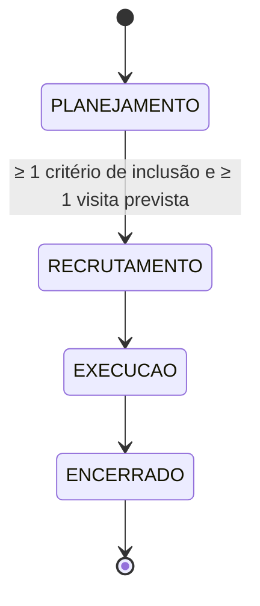

# T38 · T41 · T51 — Migrations, máquina de estados e candidatos

Base: branch `develop` (commit `f29fc73`, "Task36-code"), que já traz o modelo de domínio, a migration `V4` e o backend de recrutamento.

## T38 — Migrations Flyway e entidades JPA

O que já existia (T36-code): tabelas de critérios, visitas, ações, candidatos, avaliações, respostas, consentimentos e participações (`V4`), com as entidades e os repositórios correspondentes.

O que faltava e foi feito:

- `V5__create_study_status_history.sql`: tabela `historico_status_estudo` (estudo, estado anterior, novo estado, usuário, data/hora). A FK do estudo é `ON DELETE CASCADE` (o histórico acompanha o estudo) e a do usuário é `RESTRICT`. Um `CHECK` só aceita avanços de um estado por vez.
- Entidade `HistoricoStatusEstudo` e `HistoricoStatusEstudoRepository`.
- Contagens usadas pela máquina de estados: `CriterioRepository.contarInclusaoPorEstudo` e `VisitaPlanejadaRepository.countByEstudoId`.

Nomes: as tabelas seguem o português já usado no código (`historico_status_estudo`, e não `study_status_history` do planejamento).

## T41 — Máquina de estados do estudo

`domain/regra/MaquinaEstadosEstudo` (regra pura, sem banco nem Spring) decide; `service/EstudoTransicaoService` consulta o banco e grava o histórico.

Matriz de transições (✔ = permitida; as outras 13 combinações são recusadas):

| origem \ destino | PLANEJAMENTO | RECRUTAMENTO | EXECUCAO | ENCERRADO |
|---|---|---|---|---|
| PLANEJAMENTO | ✘ | ✔ (com pré-condições) | ✘ | ✘ |
| RECRUTAMENTO | ✘ | ✘ | ✔ | ✘ |
| EXECUCAO | ✘ | ✘ | ✘ | ✔ |
| ENCERRADO | ✘ | ✘ | ✘ | ✘ |

Erros (todos HTTP 409, no formato `{"erro": "...", "codigo": "..."}`):

| código | quando |
|---|---|
| `TRANSICAO_ESTADO_INVALIDA` | pular, voltar, repetir o estado ou sair de encerrado |
| `ESTUDO_SEM_CRITERIO_INCLUSAO` | sair de planejamento sem critério de inclusão |
| `ESTUDO_SEM_VISITA_PREVISTA` | sair de planejamento sem visita prevista |

Uso (para a T42): `EstudoTransicaoService.avancar(estudoId, destino, usuarioId)`. O método bloqueia o estudo, valida, muda o estado e grava o histórico. A restrição "só o pesquisador avança" fica no controller (`@PreAuthorize(Permissoes.ESCRITA_PLANEJAMENTO)`).

**Atenção para a T42:** `PUT /api/estudos/{id}` ainda aplica qualquer `status` recebido e `POST /api/estudos` aceita qualquer estado inicial. Para a regra valer de fato, a T42 deve fazer o PUT ignorar o `status` (ou passá-lo por `avancar`) e a criação forçar `PLANEJAMENTO`. Isso exige ajustar `EstudoServiceTest.atualizaEstudoExistente` e `RecrutamentoIntegrationTest.criterioEmUsoNaoEExcluido`, que hoje mudam o estado direto pelo PUT (inclusive voltando a planejamento).

## T51 — Backend de candidatos

Já implementado no commit `f29fc73` (`CandidatoController`, `CandidatoService`, `CandidatoRepository`, DTOs). Conferido contra a descrição da task, sem alterações:

- cadastro com código `CAND-001...` gerado sob bloqueio do estudo, nome fictício, data de nascimento no passado e contato opcional;
- só com o estudo em recrutamento (409 `ESTUDO_FORA_DE_RECRUTAMENTO`); duplicidade de nome + nascimento no estudo (409 `CANDIDATO_DUPLICADO`);
- edição até a inclusão (409 `CANDIDATO_JA_INCLUIDO` depois);
- listagem paginada por estudo com filtro de situação; detalhe com resumo da avaliação vigente e do consentimento;
- escrita só do coordenador; leitura de coordenador e pesquisador; administrador sem acesso.

## Testes adicionados

- `MaquinaEstadosEstudoTest`: as 16 combinações (só 3 válidas), as duas pré-condições e a ordem das verificações.
- `EstudoTransicaoServiceTest` (Mockito): avanço com histórico, recusas sem efeito colateral, estudo e usuário inexistentes.
- `EstudoTransicaoIntegrationTest` (H2 + Flyway): ciclo completo com histórico; valida também o mapeamento da nova entidade.
