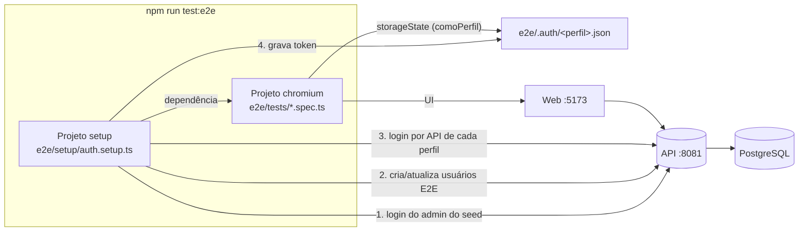

# T65 — Implementação da infraestrutura E2E (Playwright)

> Documento de referência de **como a T65 foi feita e como cada peça funciona**. Os requisitos e critérios de aceite estão em [T65 — Requisitos e critérios de aceite (E2E com Playwright)](<T65 — Requisitos e critérios de aceite (E2E com Playwright).md>).md); o passo a passo de uso está na seção "Testes E2E" do [README](../../README.md). Responsável: I7.

## 1. Visão geral

Os testes E2E abrem um Chromium de verdade, usam a aplicação web e falam com o backend e o banco reais. Hoje cobrem login válido (administrador, pesquisador e coordenador), login inválido (senha errada e e-mail inexistente), logout e a abertura de uma página protegida já autenticado. O participante usa o app mobile e fica fora.

Tudo mora em `web/ClinicalStudyPB`, e a T66 deve **só acrescentar page objects e cenários**, sem mexer em configuração nem em workflow.



## 2. Mapa dos arquivos

| Arquivo | Para que serve |
|---|---|
| `playwright.config.ts` | Configuração do Playwright: diretório, navegador, URL base, timeouts, repetições, artefatos, relatórios e os dois projetos (`setup` e `chromium`) |
| `.env.e2e.example` | Modelo versionado das variáveis, só com valores fictícios. Cada pessoa copia para `.env.e2e` (ignorado pelo Git) |
| `e2e/support/env.ts` | Lê as variáveis, valida as obrigatórias e devolve URLs e credenciais por perfil |
| `e2e/support/sessao.ts` | Chave do token no `localStorage` e caminho do arquivo de sessão de cada perfil |
| `e2e/setup/auth.setup.ts` | Roda **antes de todos os testes**: prepara usuários de teste e salva a sessão de cada perfil |
| `e2e/pages/LoginPage.ts` | Page object da tela de login |
| `e2e/pages/InicioPage.ts` | Page object da página inicial autenticada (`/inicio`) |
| `e2e/pages/BarraNavegacao.ts` | Page object do cabeçalho: logout, abrir rota pela URL e voltar |
| `e2e/fixtures/index.ts` | O `test` da aplicação (com os page objects injetados) e o helper `comoPerfil` |
| `e2e/tests/login.spec.ts` | Login válido (3 perfis), login inválido (2 casos) e logout |
| `e2e/tests/sessao.spec.ts` | Abre `/inicio` já autenticado, sem passar pela tela de login (3 perfis) |
| `tsconfig.e2e.json` | Tipos do código de `e2e/` e do `playwright.config.ts`; entra no `tsc -b` |
| `vite.config.ts`, `eslint.config.js`, `.gitignore` | Ajustes: Vitest ignora `e2e/`, ESLint com regras de Node para `e2e/`, e os artefatos ignorados pelo Git |
| `.github/workflows/ci.yml` | Job `e2e` |

## 3. Como cada peça funciona

### 3.1 Configuração (`playwright.config.ts`)

- **Variáveis:** `process.loadEnvFile('.env.e2e')` carrega o arquivo local, se existir. Ele **não sobrescreve** variáveis já definidas, então no CI valem as do ambiente. Sem o arquivo, nada quebra aqui: quem aponta o que falta é o setup (3.3).
- **`testMatch`:** só `*.setup.ts` e `*.spec.ts` dentro de `e2e/`. Os testes de componente do Vitest (`src/**/*.test.tsx`) não são vistos pelo Playwright, e o Vitest, por sua vez, exclui `e2e/**` em `vite.config.ts`.
- **Repetições:** `retries` é 0 localmente e 2 no CI (variável `CI`). `forbidOnly` falha o CI se alguém esquecer um `test.only`. No CI são 2 workers; localmente, o padrão do Playwright.
- **Artefatos:** captura de tela e vídeo só em falha; trace na primeira repetição (por isso só aparece no CI, onde há repetição). Saída em `test-results/`.
- **Relatórios:** lista no terminal e relatório HTML em `playwright-report/`. Localmente o HTML abre sozinho se houver falha; no CI nunca abre.
- **Projetos:** `setup` roda primeiro; `chromium` declara `dependencies: ['setup']`, então só começa depois que o setup passa. Se o setup falha, nenhum teste roda (e a mensagem do setup é a que aparece).

### 3.2 Variáveis (`e2e/support/env.ts`)

Obrigatórias: `E2E_BASE_URL`, `E2E_API_URL`, `E2E_BOOTSTRAP_EMAIL`, `E2E_BOOTSTRAP_SENHA` e, para cada perfil (`ADMINISTRADOR`, `PESQUISADOR`, `COORDENADOR`), `E2E_<PERFIL>_EMAIL` e `E2E_<PERFIL>_SENHA`. `exigirVariaveis()` junta **todas** as que faltam em uma única mensagem, por exemplo:

> Variáveis de ambiente dos testes E2E ausentes: E2E_BASE_URL, E2E_API_URL, … Copie web/ClinicalStudyPB/.env.e2e.example para .env.e2e

Os perfis ficam em uma lista única (`perfisE2E`); acrescentar um perfil novo é só incluí-lo ali e no `.env.e2e.example`.

### 3.3 Setup: usuários e sessões (`e2e/setup/auth.setup.ts`)

Roda a cada execução, na ordem:

1. **Valida as variáveis** (3.2).
2. **Login por API** do administrador do seed `V2` (`E2E_BOOTSTRAP_*`), que é o único que pode gerenciar usuários.
3. **Garante os usuários de teste** `e2e.administrador@…`, `e2e.pesquisador@…`, `e2e.coordenador@…`: lista `GET /api/usuarios`; se o e-mail já existe faz `PUT` (redefine nome, senha, perfil e `ativo: true`), senão faz `POST`. Por isso é **idempotente**: rodar duas vezes não duplica nem deixa uma conta inativa ou com senha antiga. A senha vai para o banco como hash BCrypt, como qualquer usuário. Os usuários E2E só existem onde o setup roda; nada disso entra em migration.
4. **Login por API de cada perfil** e gravação de `e2e/.auth/<perfil>.json`.

O formato do arquivo é o `storageState` do Playwright. O front guarda o token no `localStorage` (chave `clinicalstudypb.token`, em `src/services/api.ts`), então o arquivo é:

```json
{ "cookies": [], "origins": [ { "origin": "http://localhost:5173",
    "localStorage": [ { "name": "clinicalstudypb.token", "value": "<jwt>" } ] } ] }
```

Como o token dura 30 minutos e o setup roda a cada execução, **nunca se usa sessão vencida**. Se a chave do token mudar em `api.ts`, é preciso mudar também `CHAVE_TOKEN` em `e2e/support/sessao.ts`.

### 3.4 Sessão por perfil nos testes (`e2e/fixtures/index.ts`)

`comoPerfil('PESQUISADOR')` devolve `{ storageState: <caminho do .json> }`. Um arquivo de teste (ou bloco `describe`) usa:

```ts
test.use(comoPerfil('PESQUISADOR'))
```

e cada teste dele começa **já autenticado** em um contexto de navegador novo, sem passar pela tela de login. Os testes de login **não** usam sessão salva (o padrão é contexto vazio), justamente para exercitar a tela.

### 3.5 Page objects (`e2e/pages`)

Regra do projeto: **os testes não têm seletores soltos**, só chamam métodos dos page objects, e os localizadores usam papel ou rótulo (`getByRole`, `getByLabel`), que resistem a mudanças de HTML.

| Page object | Métodos |
|---|---|
| `LoginPage` | `goto()`, `login(email, senha)`, `expectLoggedIn()` (URL `/inicio` e botão "Sair" visível), `expectOnLoginPage()`, `expectErrorMessage(texto)`, `lerToken()` (estado de autenticação no `localStorage`) |
| `InicioPage` | `goto()`, `expectGreeting()` (título "Olá, …") |
| `BarraNavegacao` | `sair()` (clica em "Sair" e confere a volta ao `/login`), `abrirRota(caminho)`, `voltar()` |

Os page objects entram no `test` pelo `base.extend` de `e2e/fixtures/index.ts` (`paginaLogin`, `paginaInicio`, `barra`). **Os parâmetros dos fixtures se chamam `usar`, e não `use`**, de propósito: com `use` o ESLint de hooks do React confunde com o hook `use`.

### 3.6 Os testes

| Teste | O que prova |
|---|---|
| Login válido (×3 perfis) | Chega em `/inicio`, o botão "Sair" aparece e o token existe no `localStorage` |
| Senha errada | Mensagem "Credenciais inválidas", continua em `/login`, **sem token** |
| E-mail inexistente | A **mesma** mensagem "Credenciais inválidas" (não revela qual campo errou), continua em `/login`, sem token |
| Logout | Depois de entrar e abrir `/estudos`, "Sair" volta ao login e apaga o token; abrir `/estudos` de novo redireciona ao login; o botão Voltar não reabre a área autenticada |
| Sessão reaproveitada (×3 perfis) | `/inicio` abre autenticado usando só o arquivo de sessão |

Convenções para os próximos testes: cada teste é independente (contexto novo, sem depender de ordem); **nada de `waitForTimeout`**, só as esperas automáticas e os `expect` do Playwright; cenários de erro usam e-mail que não existe, para nunca bloquear conta real.

### 3.7 CI (job `e2e` em `.github/workflows/ci.yml`)

Roda em push e pull request na `main` e na `develop`, com `timeout-minutes: 20`:

1. **PostgreSQL 16** como `service`, com health check do próprio container.
2. **Backend:** `./mvnw -B -DskipTests package` e `java -jar` em segundo plano, com `DB_URL`, `DB_USERNAME`, `DB_PASSWORD` e um `JWT_SECRET` fictício. O Flyway cria o esquema e o seed no banco vazio.
3. **Web:** `npm ci`, `npm run build` com `VITE_API_URL=http://localhost:8081` e `vite preview` na porta 5173 (a origem que o CORS do backend já libera).
4. **Espera ativa:** repete `curl` em `/v3/api-docs` (backend) e `/login` (web) até responderem, e falha com o log se não subirem. Sem isso o teste falharia de forma intermitente.
5. **`npx playwright install --with-deps chromium`.**
6. **`cp .env.e2e.example .env.e2e` e `npm run test:e2e`.** Usar o exemplo no CI mantém o arquivo de exemplo sempre válido.
7. **Artefatos com `if: always()`:** `playwright-report` (relatório HTML e `test-results` com os traces), retenção de 14 dias. Em falha, também os logs do backend e do web (`logs-e2e`).

## 4. Como usar no dia a dia

Resumo (detalhes e tabela de comandos no README):

```bash
cd web/ClinicalStudyPB
npx playwright install chromium
cp .env.e2e.example .env.e2e
npm run test:e2e              # tudo
npm run test:e2e:headed       # com navegador visível
npm run test:e2e:report       # abre o relatório
```

Pré-condição: backend (porta 8081) e web (porta 5173) rodando, com o seed `V2` aplicado.

**Para criar um cenário novo (T66):** (1) crie o page object em `e2e/pages/` com localizadores por papel ou rótulo; (2) registre-o em `e2e/fixtures/index.ts`; (3) escreva o `*.spec.ts` em `e2e/tests/`, usando `test.use(comoPerfil(...))` se precisar de sessão. Configuração e workflow não mudam. Se a tela precisar de um `data-testid`, combine o nome com I5 e I6.

## 5. Como foi verificado

Executado em 31/10/2026, no ambiente local com o backend em H2 (modo PostgreSQL) e o web em `vite preview`:

| Verificação | Resultado |
|---|---|
| `npm run test:e2e` | 10 testes passando |
| `--repeat-each=10` com `--workers=1` | 91 de 91 passando (rodado antes de mover a navegação e o seletor restantes para os page objects; **repetir** antes de anexar como evidência) |
| `--repeat-each=10` com `--workers=4` | 91 de 91 passando (rodado depois da última correção) |
| Setup repetido várias vezes | Sem duplicar usuários nem falhar |
| Sem variáveis de ambiente | Setup falha listando as variáveis ausentes; os testes não rodam |
| Falha forçada com `CI=1` | 2 repetições e geração de captura, vídeo e trace |
| `npx tsc -b`, `npm run lint`, `npm test` (Vitest) | Passam; o Vitest não executa os testes do Playwright |
| `waitForTimeout` e seletores soltos nos testes | Nenhum |

## 6. Pendências e cuidados

### 6.1 O que falta para a T65 ir para Done

Em ordem; cada item destrava o seguinte.

- [ ] **Commit e push** da branch da task e abertura do PR. Sem isso o job `e2e` não existe no GitHub.
- [ ] **Job `e2e` verde no GitHub.** Ele nunca rodou lá. Localmente o banco foi H2, então o trecho com PostgreSQL real, o empacotamento do backend (`./mvnw -DskipTests package` + `java -jar`) e o `vite preview` do CI ainda não foram provados. Se falhar, o mais provável é o passo de subir o backend ou a espera de saúde; os logs saem no artefato `logs-e2e`.
- [ ] **Falha forçada no CI (requisito RQ-11/RQ-12).** Uma vez, quebre um teste de propósito (por exemplo, troque `'Credenciais inválidas'` por outro texto em `login.spec.ts`), confira que o job fica **vermelho**, baixe o artefato `playwright-report` e abra o trace (`npx playwright show-trace <arquivo>.zip`). Depois desfaça a quebra e confirme que o job volta a ficar verde. Localmente já se viu captura, vídeo e trace; o requisito pede a prova no CI.
- [ ] **PR revisado por outro integrante**, com o CI verde, e merge na `main`.
- [ ] **README validado em clone limpo** por um colega que rode os testes seguindo **só** a seção "Testes E2E". Registrar o nome de quem validou.
- [ ] **Azure Boards:** Remaining Work em 0, estado Done e um comentário avisando a T66 de que a estrutura (`e2e/pages`, `e2e/fixtures`, `e2e/setup`, `e2e/tests`) já pode ser usada. Se a task passar das 3h estimadas, registrar quanto e por quê.

### 6.2 Evidências a anexar ao PR e à task

- [ ] Link do PR aprovado por outro integrante e integrado à `main`
- [ ] Link de uma execução verde do job `e2e` na `main`
- [ ] Link ou captura da execução vermelha de propósito, com o trace aberto
- [ ] Relatório HTML do Playwright (captura ou artefato) com login válido, inválido e logout passando
- [ ] Saída do `--repeat-each=10` sem falhas (rodar de novo com `--workers=1` e com `--workers=4` na versão final)
- [ ] Link da seção "Testes E2E" do README e o nome de quem a validou em clone limpo
- [ ] Remaining Work em 0 e estado Done no Azure Boards, com o comentário para a T66

### 6.3 Cuidados

- **Ainda não verificado:** o job `e2e` **nunca rodou no GitHub Actions**. Localmente o banco foi H2, não PostgreSQL. Falta ver o job verde na `main` e, uma vez, quebrar um teste de propósito para vê-lo vermelho e baixar o trace (evidências do documento de requisitos).
- **Fora do que a T65 pode fazer sozinha:** PR revisado por outro integrante, alguém seguindo só o README em um clone limpo e a atualização do Azure Boards (Remaining Work 0, estado Done).
- **Administrador do seed:** o setup depende de `admin@clinicalstudy.test` existir (seed `V2`). Em um banco sem ele, o setup falha no login do passo 2.
- **Acoplamento com o front:** os testes dependem dos textos "E-mail", "Senha", "Entrar", "Sair" e "Credenciais inválidas" e da chave do token no `localStorage`. Mudou algum deles na tela, ajuste o page object correspondente.
- **Limite de tentativas de login:** o backend não tem hoje; se for criado, os cenários de erro podem passar a disparar bloqueio e o setup precisará de uma conta isenta.
