# Release 1 — ClinicalStudyPB

Sistema de Gestão de Estudos Clínicos (Engenharia de Software II, UEPB, 2026.2). Todos os dados são fictícios.

## 1. Objetivo e sprints abrangidas

| | |
|---|---|
| **Objetivo** | Entregar o ciclo de **planejamento e recrutamento** de um estudo clínico: usuários e autenticação, estudos, critérios, visitas e atividades, estados do estudo, candidatos, elegibilidade, consentimento simulado e inclusão de participantes com limite de vagas |
| **Sprints** | Sprint 1 (13/10 a 26/10/2026) e Sprint 2 (27/10 a 09/11/2026) |
| **Tag** | `release1` (criada pelo responsável da T72 no commit entregue) |
| **Como executar** | [README principal](../../README.md#5-instalação-e-execução); o caminho mais curto é `docker compose up --build -d --wait`, com web em http://localhost:5173, API em http://localhost:8081 e Swagger em http://localhost:8081/swagger-ui.html |
| **Credenciais fictícias** | Seed V2 e perfil `demo`, todas com a senha `senha-de-teste` (lista no [README](../../README.md#credenciais-de-demonstração-seed-flyway-v2)) |

## 2. Situação de cada requisito

| RF | Requisito | Situação | Observação |
|---|---|---|---|
| RF01 | Cadastro e gerenciamento de usuários | ✅ Concluído | Sprint 1 |
| RF02 | Autenticação e encerramento de sessão | ✅ Concluído | Web e mobile (Sprint 1) |
| RF03 | Restrição de funcionalidades por perfil | ✅ Concluído | API, web e mobile; coberto por testes de permissão por perfil |
| RF04 | Cadastro de estudos | ✅ Concluído | Sprint 1 |
| RF05 | Critérios de inclusão e exclusão | ✅ Concluído | Peso e critério determinante; só em planejamento |
| RF06 | Visitas previstas e atividades | ✅ Concluído | Dia e tolerância; atividades por visita |
| RF07 | Estados do estudo | ✅ Concluído | Máquina de estados com histórico; avanço só pelo endpoint de transição |
| RF08 | Cadastro de candidatos | ✅ Concluído | Código `CAND-NNN` por estudo, lista paginada e filtro por situação |
| RF09 | Avaliação de elegibilidade | ✅ Concluído | Regra no domínio, pontuação, critérios reprovadores e histórico de reavaliações |
| RF10 | Consentimento simulado | ✅ Concluído | Termo simulado, comprovante com data, responsável e versão |
| RF11 | Inclusão de participantes e limite de vagas | ✅ Concluído | Quatro pré-condições; limite garantido sob concorrência por bloqueio do estudo |
| RF12 – RF16 | Acompanhamento | ⏳ Não implementado | Previsto para a Release 2 |
| RF17 – RF20 | Aplicativo do participante | ⏳ Não implementado | O app mobile desta release só tem o login (RF02); funcionalidades na Release 3 |
| RF21 – RF22 | Monitoramento | ⏳ Não implementado | Previsto para a Release 3 |

## 3. Funcionalidades

Capturas geradas com a aplicação real e os usuários fictícios de demonstração (imagens em [`docs/imagens/`](../../docs/imagens/)).

| Fluxo | Sucesso | Erro |
|---|---|---|
| Login (RF02) | 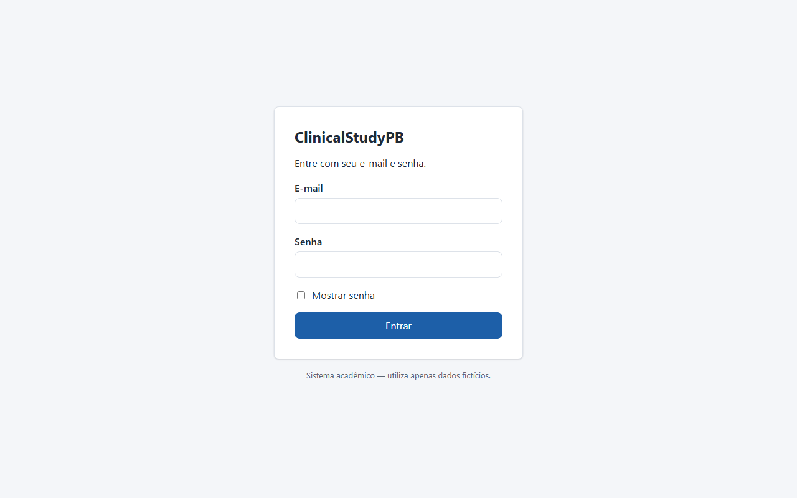 | 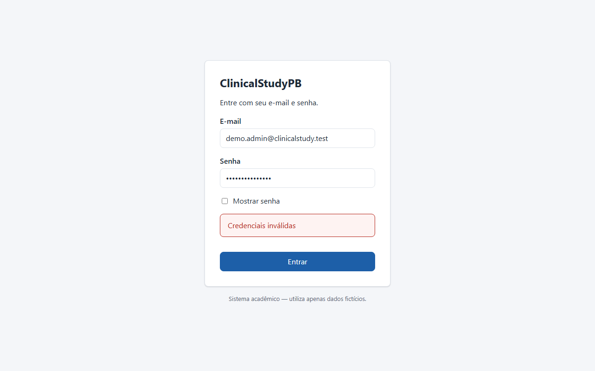 |
| Usuários (RF01) e perfil sem acesso (RF03) | 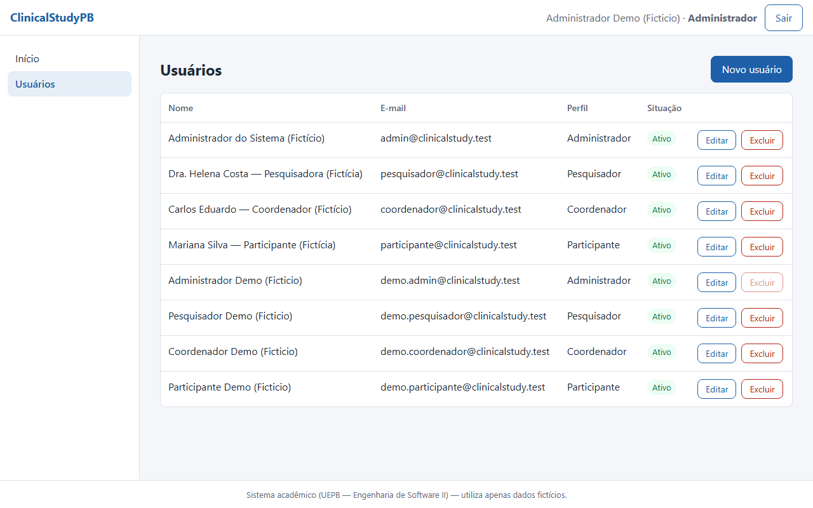 | 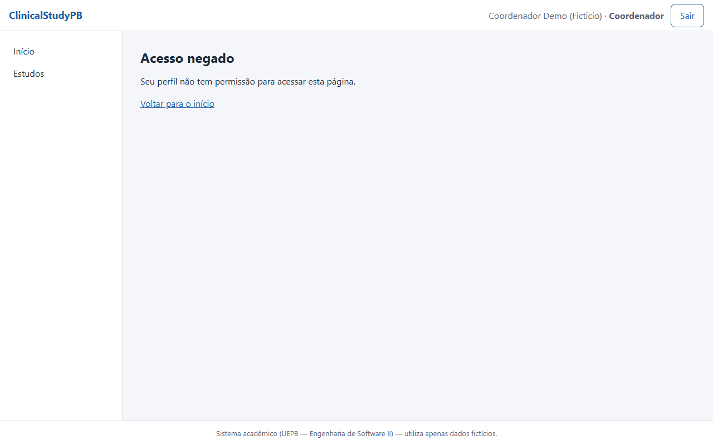 |
| Estudos (RF04) e estado (RF07) | 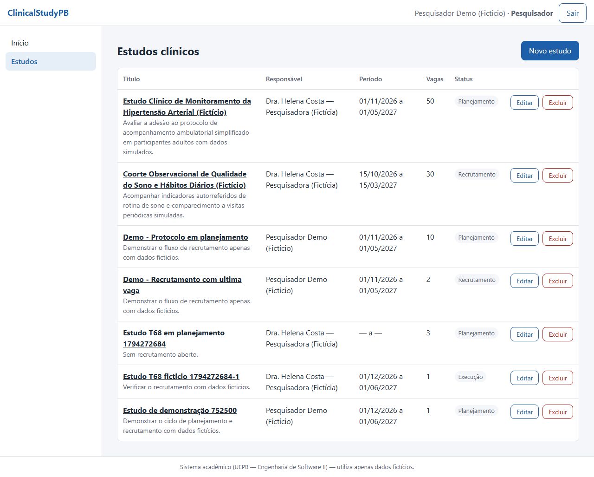 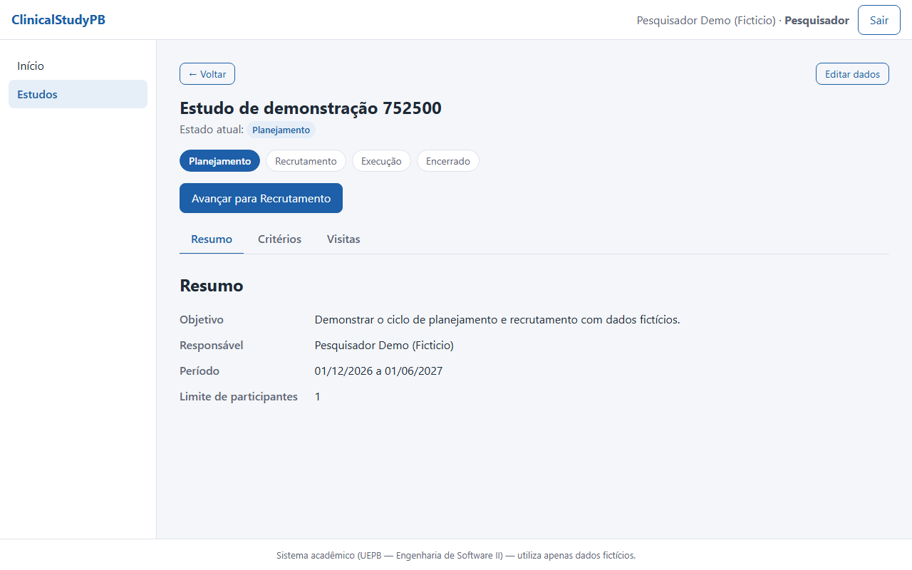 | |
| Critérios (RF05) | 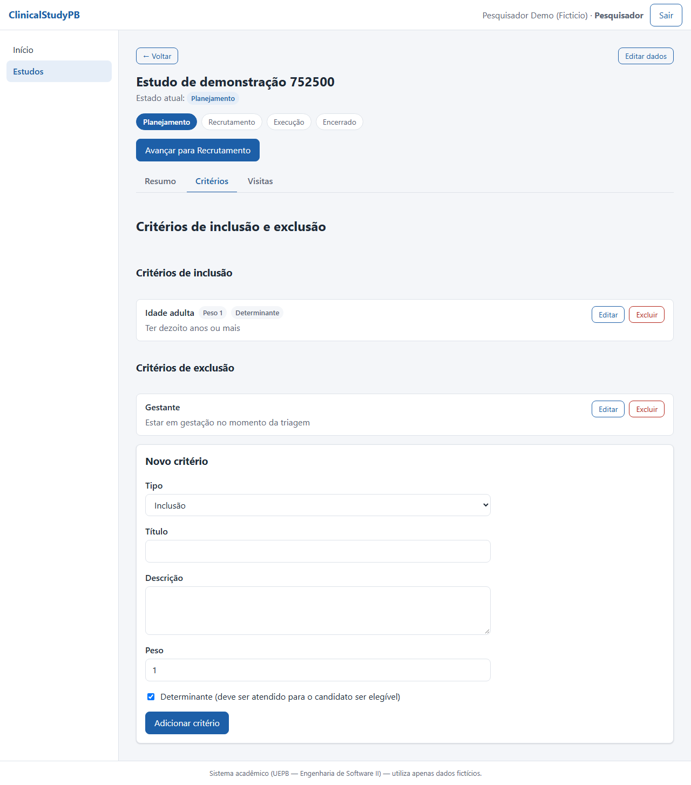 | |
| Visitas e atividades (RF06) | 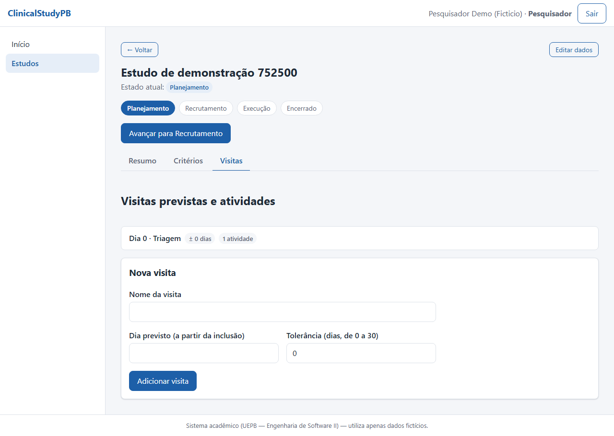 | |
| Candidatos (RF08) | 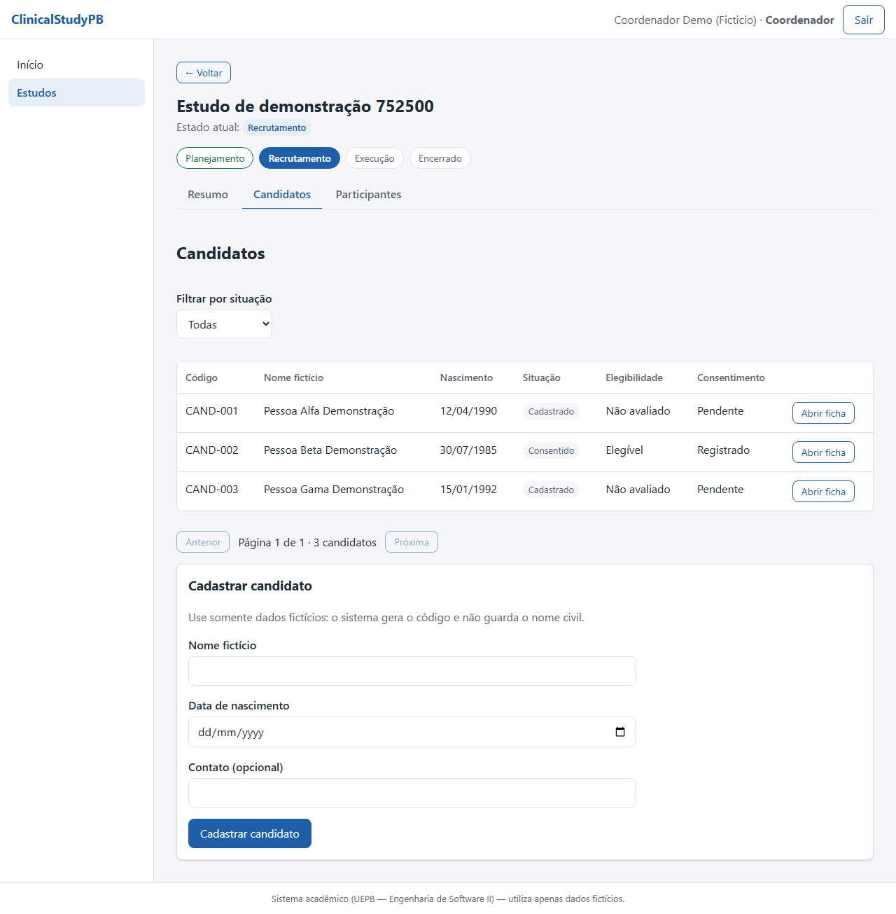 | |
| Elegibilidade (RF09) | 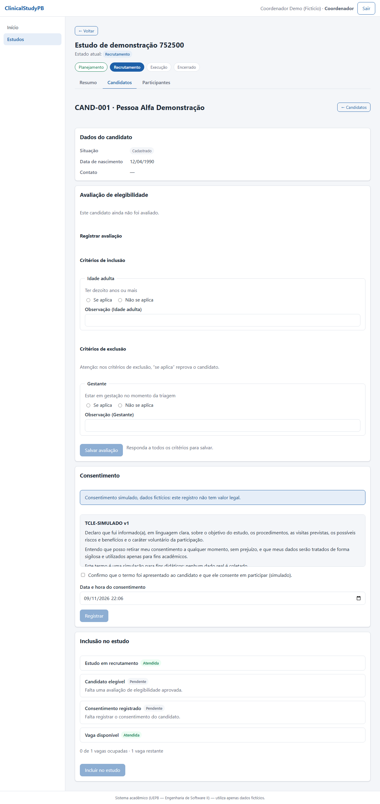 | 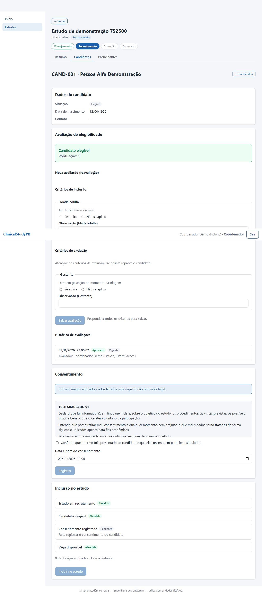 |
| Consentimento (RF10) |  |  |
| Inclusão (RF11) | 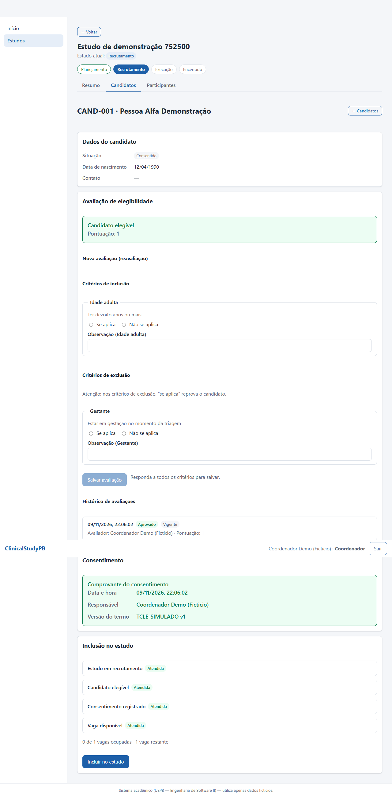 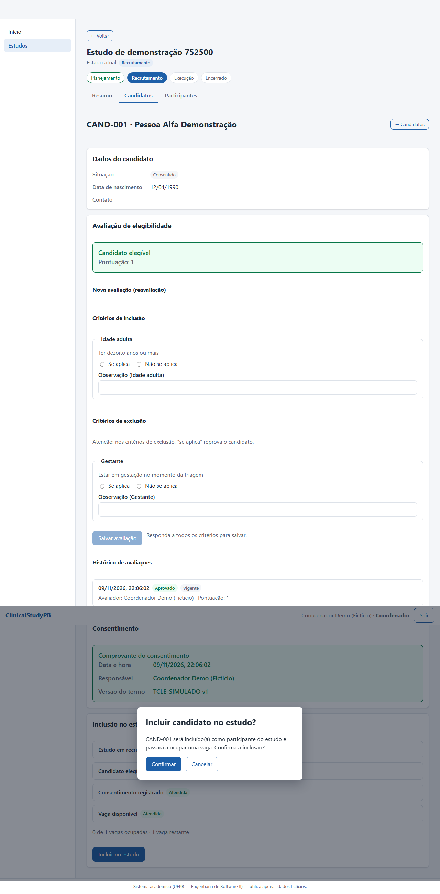 | 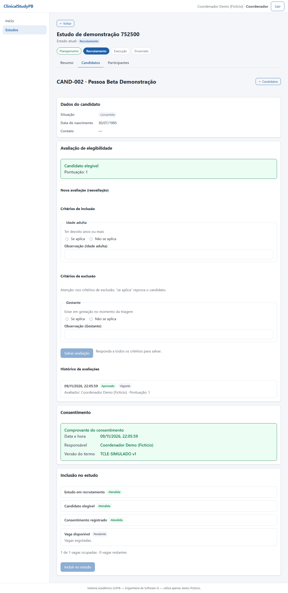 |
| Participantes (RF11) | 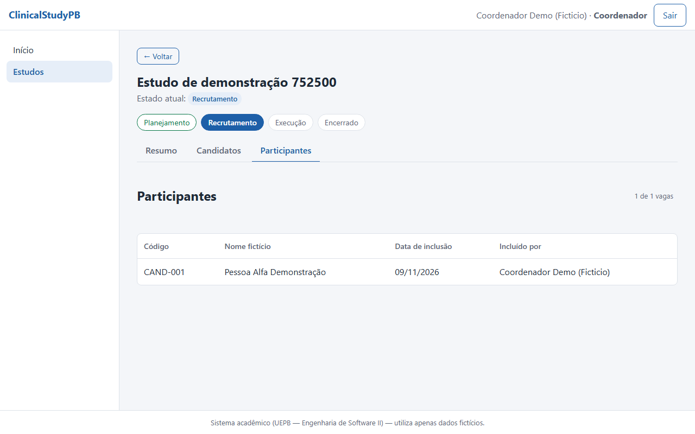 | |

## 4. Alterações de arquitetura e de stack

Em relação ao planejamento da Sprint 1 (Stack A mantida: Spring Boot, React + TypeScript, React Native + Expo, PostgreSQL):

- **Contrato primeiro:** o OpenAPI da Sprint 2 ([`docs/api/openapi-sprint2.yaml`](../../docs/api/openapi-sprint2.yaml)) foi escrito antes do código; um teste do backend (`ContratoOpenApiTest`) compara o contrato com a API, e o web gera seus tipos com `openapi-typescript` e roda sobre mocks (MSW) até a API existir.
- **Estado do estudo** por endpoint de transição (`POST /api/estudos/{id}/transicoes`) com histórico; o `PUT` do estudo não muda mais o estado.
- **Concorrência:** a inclusão de participantes bloqueia o estudo (`SELECT ... FOR UPDATE`) para nunca passar do limite de vagas.
- **Erros padronizados:** `status`, `codigoRegra`, `mensagem` e `errosCampo`; a web traduz o código em mensagem clara.
- **Docker Compose** (PostgreSQL 16 + backend + web em nginx) e **CORS configurável** por `CORS_ALLOWED_ORIGINS` (T67).
- **Perfil `demo`** do Spring: dados fictícios de demonstração carregados só quando o perfil está ativo (T63).
- **Qualidade:** JaCoCo com bloqueio de 80% no CI (T64), Vitest + Testing Library no web, Playwright para os fluxos E2E (T65 e T66) e dois roteiros executáveis pela API (`scripts/verificar-ambiente.py` e `scripts/verificar-recrutamento.py`).
- Diagramas atualizados em [`docs/diagramas/`](../../docs/diagramas/): casos de uso, domínio, arquitetura e as sequências de "avançar o estado" e "incluir participante".

## 5. Resultados dos testes e da cobertura

Executados em 09/11/2026 com os mesmos comandos do CI.

| Suíte | Comando | Resultado |
|---|---|---|
| Backend (JUnit, MockMvc, Mockito, H2) | `./mvnw -B verify -Djacoco.haltOnFailure=true` | **419 testes, 0 falhas**; cobertura de linhas do código de negócio (domínio e serviços) **99,2%** (584 de 589), com o mínimo de 80% bloqueando o build |
| Backend contra PostgreSQL | job `Backend (PostgreSQL)` do CI | mesmas migrations e consultas validadas no banco de produção |
| Web (Vitest + Testing Library + MSW) | `npm test`, `npm run lint`, `npm run build` | **130 testes, 0 falhas**; lint e build sem erros |
| E2E (Playwright, navegador real contra backend e banco reais) | `npm run test:e2e` | **29 testes**: login, fluxo completo do recrutamento (pesquisador e coordenador), regras de erro, vagas esgotadas, acesso por perfil e regressão da Sprint 1 |
| Roteiro do planejamento (T67) | `python3 scripts/verificar-ambiente.py` | verificações de ambiente, RF01 a RF04 e RF05 a RF07; executado no job Docker do CI |
| Roteiro do recrutamento (T68) | `python3 scripts/verificar-recrutamento.py` | **58 de 58** verificações em execução local com os dados de demonstração |
| Concorrência (T62) | `ParticipacaoConcorrenciaTest` | com 6 inclusões simultâneas para 2 vagas, exatamente 2 são aceitas; sem o bloqueio o teste falha |

O relatório de cobertura do JaCoCo é publicado como artefato `cobertura-jacoco` em cada execução do CI e o relatório do Playwright como `playwright-report`.

## 6. Problemas conhecidos

| Problema | Efeito | Situação |
|---|---|---|
| O app mobile só tem o fluxo de login | O participante ainda não consulta visitas nem pede retirada | Escopo das Releases 2 e 3 |
| O app mobile não tem testes automatizados | Só lint e verificação de tipos no CI | Previsto para a Sprint 3 |
| `AuthContext` e `Login` (PR #5) não estão ligados ao roteador | A tela usada é a `LoginPage` com `SessaoProvider`; os dois arquivos novos ficam disponíveis, testados, mas sem uso | Decisão do time: remover ou adotar |
| O job "Ambiente Docker (T67)" depende do Docker do GitHub Actions | O roteiro foi validado fora do Docker (H2 com perfil `demo`); a execução no PostgreSQL do compose é a do CI | Conferir o job verde no PR |
| Estudo sem dono de edição | Qualquer pesquisador edita e exclui estudos de outro pesquisador (o RF04 não exige dono) | Decisão de produto registrada no README |
| Cobertura do web não é medida | Há testes, mas sem meta numérica no CI | Melhoria futura |

## 7. Processo de desenvolvimento (Sprints 1 e 2)

### Backlog e tarefas

- **Sprint 1:** 35 tasks (repositório e arquitetura, Spring Boot e PostgreSQL, usuários, autenticação, React, estudos, mobile e protótipos); situação em [`docs/sprint1/status-sprint1.md`](../../docs/sprint1/status-sprint1.md).
- **Sprint 2:** 37 tasks (T36 a T72) em 10 PBIs (base técnica, RF05 a RF11, qualidade e documentação); planejamento em [`docs/sprint2/Planejamento_da_Sprint_2_ClinicalStudyPB.md`](../../docs/sprint2/Planejamento_da_Sprint_2_ClinicalStudyPB.md) e CSV de importação em [`docs/azure-boards/sprint2-backlog.csv`](../../docs/azure-boards/sprint2-backlog.csv). Cada task tem um guia de implementação em [`docs/design/`](../../docs/design/sprint2/README.md).

### Papéis e contribuições

| Integrante | Papel | Tasks planejadas na Sprint 2 |
|---|---|---|
| I1 | Scrum Master, arquitetura e DevOps | Modelo de domínio e contrato OpenAPI (T36, T37), inclusão de participantes (T60), cobertura mínima no CI (T64), tag e apresentação (T72) |
| I2 | Product Owner, testes e documentação | Testes de estados, elegibilidade e vagas (T44, T56, T62), diagramas (T69), READMEs (T70, T71) |
| I3 | Backend: domínio, persistência e estudos | Migrations e entidades (T38), máquina de estados (T41), candidatos (T51), elegibilidade (T54) |
| I4 | Backend: usuários, segurança e autorização | Transição de estado (T42), critérios (T45), visitas (T48), testes de candidatos (T53), consentimento (T57), dados de demonstração (T63) |
| I5 | Frontend React: autenticação e integração | Tipos e mocks (T40), telas de visitas, candidatos e consentimento (T49, T52, T58), integração do recrutamento (T68) |
| I6 | Frontend React: estudos e protótipos | Detalhe do estudo, estado, critérios e inclusão (T39, T43, T46, T61), ambiente Docker e integração do planejamento (T67) |
| I7 | Mobile, protótipos e testes | Testes de critérios, visitas, consentimento (T47, T50, T59), tela de elegibilidade (T55), infraestrutura e fluxo E2E (T65, T66) |

A tabela segue o planejamento da Sprint 2 (papéis e tasks atribuídas). Na prática algumas tasks foram executadas por outros integrantes, e o histórico do Git (`git shortlog -sn`) e o Azure Boards registram quem fez cada uma; os nomes de cada integrante entram na tabela da equipe do README principal.

### Burndown e revisão

Esta seção depende de dados que só existem no Azure DevOps e na retrospectiva, por isso o time precisa completá-la antes da entrega:

- **Burndown da Sprint 2 (Azure DevOps):** inserir a imagem do gráfico final e a análise do planejado contra o realizado. Referência do planejamento: 143 horas para 37 tasks, margem de 25 horas para o *carry-over* da Sprint 1, cerimônias e defeitos de integração.
- **Revisão e retrospectiva:** registrar os impedimentos (por exemplo, divergências entre branches que exigiram a junção `fix/unir-main-e-develop`, e a dependência do Docker para validar a T67) e as ações de melhoria acordadas.
